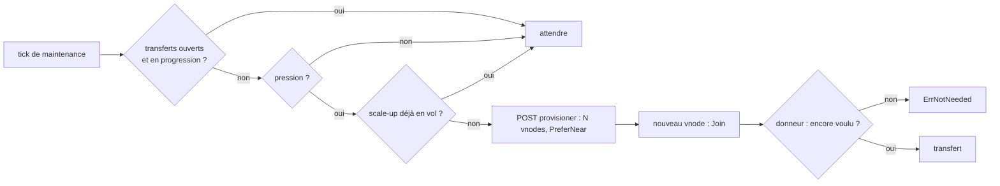

# Autoscale

> **Transition du 25 novembre 2026.** Cette carte décrit le prédécesseur.
> Les appels liés aux preuves globales, aux checkpoints et au placement doivent
> être relus avec le [nouveau contrat](../protocol/local-permissions.md).
> La [qualification](../protocol/local-permissions-verification.md) distingue
> remplacement branché et qualification distincte ; aucun ancien benchmark ne qualifie celle-ci.

**Statut : actuel.** Code : `indexus/autoscale.go` (`AutoscaleTick`,
`holdForTransfers`), `internal/autoscale/autoscale.go` (`Controller.Tick`,
`evaluatePressure`), `internal/adapter/provisioner`, `cmd/provisioner`,
`ops/experiment/elastic/spawn.sh`.
Règles : AUTO-1, AUTO-2, AUTO-3, SCALE-1, SPAWN-1, JOIN-1, COLD-2, HOT-1
([registre](../protocol/invariants.md)).

## Ce que fait l'autoscale, et ce qu'il ne fait pas

L'autoscale **demande de la capacité** : un vnode sous pression demande au
provisioner d'en démarrer d'autres. Il ne donne aucun droit d'écrire et ne
déplace aucune donnée. Ce sont les nouveaux vnodes qui rejoignent le réseau et
prennent une part de la cellule par un transfert
([transfert-de-zone.md](transfert-de-zone.md)).

Il ne réduit pas non plus la topologie : un vnode froid est replié par
compaction causale (COLD-2).

## Quand il demande

`Controller.Tick` évalue la pression (`evaluatePressure`) sur une fenêtre. Les
signaux sont la mémoire, le CPU, le disque libre, le nombre d'items possédés
(`ItemsLimit`) et le débit d'écriture (`WritesLimit`). Chacun a son seuil et sa
durée de maintien, et un délai de refroidissement de 15 s par défaut suit
chaque demande. Le mode `ItemsOnly` sert aux expériences sur hôtes partagés.

### Portée des signaux : le vnode et sa machine

Plusieurs vnodes peuvent partager une machine. Un signal a donc une portée,
et la demande la dit.

| Signal | Mesure | Portée |
| --- | --- | --- |
| `items` | items possédés (comptage consultatif) | vnode |
| `writes` | écritures arrivées par seconde chez ce détenteur | vnode |
| `queue` | écritures arrivées et pas encore répondues, âge de la plus ancienne | vnode |
| `cpu`, `cpu_rise` | le plus chargé du processus et de la machine | vnode ou machine |
| `mem`, `mem_filling`, `mem_rise` | le plus grand de la mémoire du processus et de celle de la machine | vnode ou machine |
| `disk` | disque libre du chemin de stockage | inchangé |

**CPU.** L'échantillon expose deux valeurs : `cpu_process_pct`
(`getrusage` du processus, sur tous les cœurs) et `cpu_host_pct`
(`/proc/stat`, entre deux lectures). La valeur évaluée, `cpu_pct`, est la plus
grande des deux : un vnode voit sa machine, comme le placeur. Est compté
occupé tout ce qui n'est pas `idle` : `user`, `nice`, `system`, `irq`,
`softirq`, mais aussi `iowait` et `steal` (`guest` est déjà dans `user`).
C'est la définition du placeur (`cmd/experiment`, `hostCPUMeter`) : les deux
doivent juger une machine de la même façon. `iowait` est aussi exposé à part
(`cpu_host_iowait_pct`). Sans `/proc/stat` (macOS), la valeur du processus
tient lieu de valeur évaluée et `cpu_host_ok` vaut `false`.

**Raison `host_pressure`.** Un signal CPU ou mémoire vient de la machine
quand elle a été mesurée et que le processus seul reste sous le seuil de
cette ressource. La demande porte alors `"reason": "host_pressure"` et le
signal lui-même dans `"signal"` (`cpu`, `cpu_rise`, `mem`, `mem_filling`,
`mem_rise`). Si le processus franchit seul le seuil, ou si `items`, `writes`
ou `queue` déclenche, la raison reste celle du vnode.

Tous les vnodes d'une machine chaude envoient `host_pressure`, chacun avec
son propre `prefer_near`. Le nœud ne voit pas ses voisins et ne connaît pas
leur nombre de façon fiable : il ne cherche pas à savoir s'il est le plus
chargé. **La fusion en une décision physique par machine est faite par le
provisioner** ; côté nœud il n'y a que la raison, la demande unique en vol
(SCALE-1) et le délai de refroidissement.

**Transfert sortant.** Un vnode qui copie déjà un transfert vers un receveur
(`transfers_in_flight` > 0, les jobs donneurs de `mesh.Service`) n'envoie pas
`host_pressure` : son soulagement est en route, et un receveur de plus est
une copie de plus sur la même machine. Il demande toujours pour ses propres
signaux (`items`, `writes`, `queue`), pour un seuil franchi par son processus
seul, et à l'urgence mémoire (`mem` au seuil de refus). La pause AUTO-3
ci-dessous reste en amont : tant qu'un transfert ouvert progresse sans droit
délégable, le tick n'évalue rien.

Champs ajoutés au `POST /v1/scale` : `signal`, `transfers_in_flight`,
`cpu_process_pct`, `cpu_host_pct`, `cpu_host_ok`. `reason` existait.
Champs ajoutés à `autoscale.pressure` (`/metrics`, `/status`, `/autoscale`) :
`cpu_process_pct`, `cpu_host_pct`, `cpu_host_ok`, `cpu_host_iowait_pct`,
`mem_process_pct`, `mem_host_pct`, `oldest_wait_ms`, `transfers_out`,
`host_pressure`, `host_pressure_waits_for_transfer`. `cpu_pct` et `mem_pct`
gardent leur nom et désignent la valeur évaluée.

Tests : `TestVNodesSharingAHotHostAskWithHostPressure` (2 puis 5 vnodes),
`TestVNodeOverItsOwnCPULimitKeepsItsOwnReason`,
`TestOutgoingTransferHoldsHostPressureNotOwnQueue`,
`TestHostCPUBusyFractionBetweenTwoSamples`,
`TestHostCPUFallsBackToProcessWithoutProcStat`,
`TestAutoscaleTickPostsHostPressureForAHotHost`.

### Demande mesurée à l'arrivée

Le débit qui déclenche `writes` n'est plus compté après l'application. Quand
le store bloque, les ACK ralentissent : un compteur d'écritures servies
baisse au moment où la demande monte (run AWS du 26 novembre 2026). Les
compteurs de `mesh.WriteDemand` sont pris à l'entrée de `handleWrite` :

| Compteur (`/metrics`, bloc `demand`) | Sens |
| --- | --- |
| `received` | requêtes d'écriture entrées dans ce vnode |
| `forwarded` | requêtes passées à un autre détenteur (net des retours) |
| `arrived` | `received - forwarded` : écritures arrivées chez leur détenteur |
| `retried` | nouvelles tentatives d'une requête que ce vnode venait de refuser à une bascule ; non recomptées dans `received` |
| `in_flight` | arrivées et pas encore répondues (jauge) |
| `oldest_wait_ms` | âge de la plus ancienne écriture en vol suivie (jauge) |
| `applied`, `acknowledged` | écritures appliquées, écritures répondues sans erreur |
| `refused`, `refused_by` | refus locaux, par nature (`overload`, `frozen`, `not_owner`, `not_ready`, `capacity`, `canceled`, `other`) |
| `transfers_out` | jobs donneurs en cours (jauge) |

Un saut de relais n'est pas une arrivée chez le relais : la requête y est
comptée dans `received` puis dans `forwarded`. La nouvelle tentative interne
de `callWrite` (même `RequestID`, même destination, après un refus de
bascule) est reconnue par une table de 1 024 empreintes des identifiants
venant d'être refusés ; une empreinte écrasée entre-temps ferait compter la
tentative deux fois. Le rejeu par un client d'une requête déjà acquittée
reste une arrivée.

Le chemin d'écriture ne prend aucun verrou et n'alloue rien pour ces mesures
(compteurs atomiques). `oldest_wait_ms` vient de 256 cases d'heure d'arrivée :
exact jusqu'à 256 écritures en vol ; au-delà, les premières arrivées gardent
leur case, donc un store bloqué reste vu, mais une écriture sans case n'est
pas suivie et la valeur devient une borne basse.

`AutoscaleTick` donne au contrôleur le débit d'arrivée (`WriteRate`), les
écritures en vol (`Queue`, auparavant toujours 0) et l'âge de la plus ancienne
(`OldestWait`). Le signal `queue` déclenche, sans durée de maintien, quand :

- la plus ancienne écriture en vol attend depuis `QueueWaitLimit` (2 s par
  défaut, au-dessus des attentes bornées d'une écriture saine : bascule 500 ms,
  ACK de réplica 1 s) ;
- ou le nombre d'écritures en vol atteint `QueueLimit` (par défaut
  `WritesLimit × QueueWaitLimit`, soit 1 000 pour 500/s ; absent sans
  `WritesLimit`).

Il ne dépend ni des applications ni des ACK : il reste vrai quand le store ne
répond plus, y compris quand les clients, tous en attente, n'envoient plus
rien. Il reste actif en mode `ItemsOnly`. L'ancien compteur `Service.Demand`
est conservé mais n'alimente plus l'autoscale.

Tests : `TestBlockedStoreKeepsDemandVisibleAndControllerHot`,
`TestRelayedAndRetriedWritesArriveOnceAtTheHolder`,
`TestWriteDemandTracksOldestWaitWithoutAllocating`,
`TestQueueLimitFollowsWriteLimit`, `TestMetricsExportWriteDemand`.

Une seule demande peut être en vol par vnode (SCALE-1). Elle se termine quand
un vnode actif apparaît à moins de 64 bits de la cible (SPAWN-1), ou au bout de
3 minutes (`scaleUpPatience`) si aucun n'est apparu. Une temporisation HTTP
explicite (429) donne le délai restant en millisecondes. Si le hook certifie
qu'il attend de la capacité avant d'avoir envoyé une commande de lancement
de vnode, le provisioner renvoie `waiting_for_capacity` pour une demande
individuelle. Un boot EC2 indépendant peut déjà être en cours. Le prochain
essai se répartit aléatoirement dans le tiers médian de la fenêtre de 15 s
des réservations, soit entre 5 et 10 s. Pour une pression continue, un
donneur recevant ces réponses émet au plus un renouvellement toutes les 5 s.
Le prochain tick réévalue la pression avant de redemander. Une expiration
de l'appel réseau reste ambiguë et conserve la patience ordinaire.

La demande indique où placer les nouveaux vnodes : `PreferNear`, tiré d'un plan
de topologie validé (HotTrie ou ADD régional, HOT-1). Sans plan valide, aucune
demande ne part.

La réservation durable d'un plan est distincte de cette demande en vol. Elle
retient un point cible et le propriétaire de placement de ce point avant la
demande. Le processus qui arrive conserve une identité neuve (SPAWN-1) : son
nom n'est donc pas comparé au nom exact de la cible.

Dès que la vue de placement place ce point chez un autre vnode actif, la
réservation est satisfaite et retirée lors de la fusion de membership. Le
planificateur réévalue ensuite la charge restante. Une annonce éloignée qui ne
change pas ce propriétaire et un changement d'adresse physique du même vnode
ne satisfont pas la réservation. Une identité retirée ne compte pas comme un
propriétaire actif. Le rejeu d'une
annonce ne recrée pas une réservation effacée.

Il s'agit d'une décision de capacité, jamais d'une preuve de droit d'écrire :
les droits installés sur disque continuent seuls à autoriser un ACK. L'activation
d'un premier morceau peut donc débloquer la planification sans attendre la
copie de toute une région. La nouvelle forme de ces métadonnées locales n'a
pas de conversion des anciennes réservations de disques de développement.

`ClientWritesBlocked` ne refuse les écritures clientes qu'en cas
d'épuisement mémoire mesuré. Un provisionnement en cours n'est jamais une
raison de refuser une écriture autorisée.

## Pendant un transfert (AUTO-3)

**Garantie.** Tant que les transferts de ce disque progressent, l'autoscale ne
prend pas de décision. Pendant un transfert, les zones et items possédés
bougent : ils seraient comptés deux fois. L'autoscale attend aussi longtemps que
nécessaire tant que des étapes sont commitées. Il reprend s'il n'y a eu aucune
étape commitée pendant 3 minutes (`transferStallLimit`), depuis la dernière ou
depuis que le transfert a été vu ouvert, et il l'annonce par un seul warning.

**Mécanisme.**

- **Une étape** est un commit `updateCausal` qui a réellement écrit : la seq
  zonelog a avancé sous `writeMu` (`Store.LastTransferStep`). Cela couvre le
  début, le gel, le stage, l'émission, l'installation, l'ACK, la fin,
  l'annulation, la collecte, un déplacement ou un drain à froid.
- **Ne comptent pas** : un appel qui ne change rien, une fusion de membership
  (gossip), une écriture de secours.
- **Après un redémarrage**, le délai repart de zéro.

**Ce que la reprise ne fait pas.** Elle se contente de redemander de la
capacité. Elle ne relance pas le transfert bloqué et ne l'abandonne pas. Qu'un
nouveau transfert puisse démarrer, c'est toujours le protocole de transfert qui
en décide.

Tests : `TestHoldForTransfersFollowsStepsNotTotalDuration`,
`TestLastTransferStepCountsOnlyCommitsThatWrite`.

## Côté donneur

Un vnode démarré par l'autoscale le dit dans sa demande de handoff
(`Request.Spawned`). Le donneur ne lui cède rien s'il n'a plus été sous
pression depuis 30 s (`wantedFor`), et lui répond `ErrNotNeeded`.

## Mesures

[../benchmarks/elasticity.md](../benchmarks/elasticity.md) et
[../benchmarks/ramp.md](../benchmarks/ramp.md) (AWS, avec commits et
commandes). Les runs du 23 novembre 2026 en `STEP_ROUTE=direct` ne sont pas
encore consignés dans ces pages.

### Capacité physique et capacité du protocole

Le harnais AWS distingue le nombre initial de machines, les slots par machine
et la limite de flotte. Cette dernière est une politique rechargeable, bornée
par le budget, le quota vCPU et une éventuelle limite opérateur ; elle ne fige
plus un nombre maximal de vnodes dans le provisioner au démarrage.
Le détail et la commande de mise à jour sont dans
[Machines on demand](../../ops/experiment/README.md#machines-on-demand-aws).
Une autorisation de lancer une machine ne constitue jamais une autorité de zone.

La cible CPU par défaut est 60 %. Sous Linux, les facts de placement prennent
le maximum entre la somme du CPU des vnodes et le CPU total de l’hôte
(`/proc/stat`, attente d’I/O et CPU volé inclus comme capacité indisponible). Pour admettre un nouveau receveur, le placement
ajoute au CPU mesuré son coût estimé et exige que le total reste dans cette cible.
Il conserve au moins 40 % de mémoire et de disque libres lorsque les mesures
sont disponibles. Un plafond de flotte ne permet plus de forcer une destination
qui échoue à ces contrôles. Un inventaire modifié entre décision et application
ne déclenche plus un repli sur un slot non contrôlé : la cible choisie est gardée
et un endpoint devenu indisponible fait échouer le spawn. Ce sont des cibles sur mesures, pas des limites matérielles
instantanées. Le mode historique sans faits de ressources, fondé sur les slots,
ne fournit pas cette admission ; les campagnes de ressources doivent disposer
de leurs agents `/facts` et contrôler les raisons de placement.

Le harnais active les signaux CPU/mémoire/disque avec `RESOURCE_SIGNALS=true`,
y compris en présence de `ITEMS` et `SCALING_WRITES`. Voir le
[dimensionnement du scénario 16k/s](../benchmarks/aws-16k-sizing-2026-11-26.md).

### Demande mesurée pendant un transfert

Le compteur de demande continue désormais d’être échantillonné pendant les
transferts. Une reprise du contrôleur ne moyenne donc plus le débit actuel sur
toute la durée d’un join. La protection AUTO-3 reste en place : une décision
qui redélègue des zones exige une charge retenue et une autorité stables.
Le harnais peut déclencher sur `SCALING_WRITES`, indépendamment de `WRITE_CAP` ;
`ITEMS=0` désactive le seuil de volume. Voir le
[diagnostic et les validations](../benchmarks/transfer-recovery-20261124.md).

## Coût de préparation et progression

Le spawn énumère maintenant les noms du plan validé entier, dans son ordre, puis
les réserve durablement. Il ne construit plus un DAG d'activation uniquement
pour ordonner ces noms. L'ancien modèle reste un test historique, pas un accord
global préalable au ticket d'un morceau.

Un transfert ouvert ne bloque plus à lui seul la demande : un droit natif déjà
installé et délégable peut soulager le nœud avant la fin du join. Si aucun droit
n'est délégable, la pause attend la progression des transferts ; les trois minutes
concernent l'absence de progrès. Cela ne restitue jamais un droit par timeout.
Voir [l'analyse](../design/scaling-and-control-costs.md).
