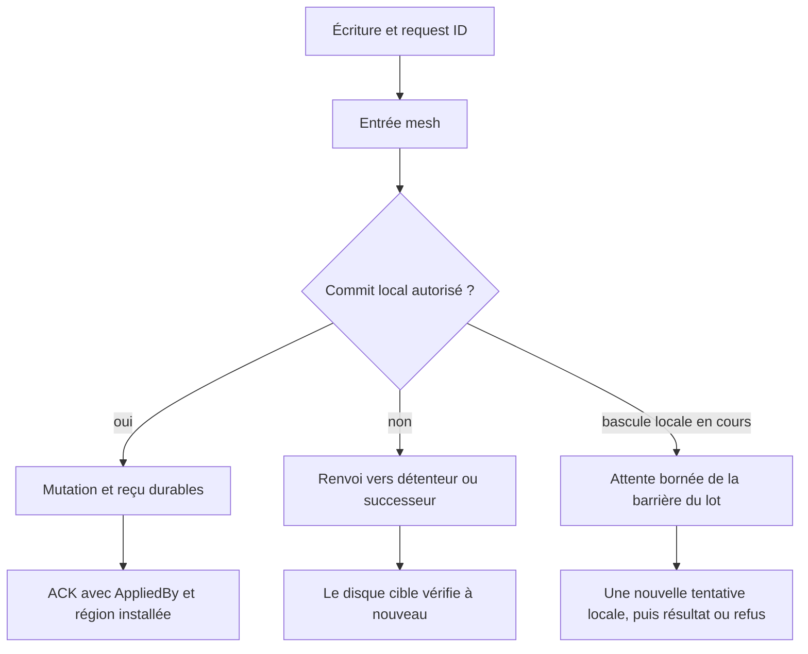

# Chemin d'une écriture

**Statut : actuel, 25 novembre 2026.** Les anciens chemins `AsyncKnowledge`,
`carryFull` et `routeOf` ne sont plus des options du runtime. Leur
[carte historique](../archive/chemin-ecriture-before-cleanup-20261125.md)
conserve les décisions et anciennes mesures.

## Une adresse ne donne pas le droit d'écrire

La membership et les indices appris des ACK servent à choisir une destination.
Ils peuvent être en retard. Le disque destinataire vérifie dans la transaction
le droit installé et la fence qui concernent la zone. La fin du join n'est pas
une condition de l'ACK d'un morceau déjà installé.

`Node.meshWrite` valide les clés et fabrique un identifiant de requête si
l'appelant n'en a pas fourni. Il donne trente secondes à l'appel mesh ; ce budget
n'est pas une expiration d'autorité. La mutation entre dans `MeshData`, puis
`Service.handleWrite`. Aucun paquet de membership n'est construit dans cet appel.

`Store.ApplyRecordContext` vérifie l'autorité, la déduplication et la capacité
avant de publier le lot durable. Les refus d'autorité sont orientés par
`ZoneHolder` et les indices récents. Chaque destinataire contrôle à nouveau son
propre disque : un indice faux n'autorise pas le mauvais nœud à acquitter.
Le parcours garde les vnodes visités pour éviter une boucle sans fin.

Lorsqu'une barrière locale de bascule existe, l'entrée peut attendre jusqu'à
500 ms, ou moins si son contexte expire, puis refaire une tentative. Ce plafond
est celui d'une attente locale de barrière, **pas de la latence totale d'écriture**.
Files, fsync, réseau et réessais du client s'ajoutent.

Lorsque `ReplicateWrites` est activé, la réponse peut aussi inclure le travail
et le résultat de réplication configurés. Cela ne transforme pas une copie shadow
en détenteur du droit. Les mesures doivent préciser ce mode.

## Ce qu'apprend un ACK

La réponse fournit `AppliedBy` et `AppliedRegion`. La région vient du disque qui
a appliqué la mutation, pas d'une cellule XOR supposée à l'entrée. Une permission
par point n'annonce que ce point ; un morceau natif peut inclure des adresses
vides. Les morceaux encore sortants ne sont pas annoncés comme un droit stable.
Un défaut de cache réduit l'indice au point sans reconstruire le contrôle pour
améliorer la réponse.

Le générateur direct apprend ces régions et conserve leurs compléments. Les
caches internes des nœuds et de `mesh.Writer` restent par zone : une nouvelle zone
peut donc nécessiter un premier relais. Première installation, premier ACK chez
le receveur, première route directe et fin du join sont quatre mesures distinctes.

Le transport de membership fonctionne en arrière-plan, avec reçus de versions,
travail en vol borné et synchronisation périodique. Un échec de ce transport ne
révoque pas une permission installée. Sa préparation reste coûteuse avec beaucoup
de membres : voir [les coûts restants](../design/scaling-and-control-costs.md).

## Écritures de secours (fallback)

La réception et la réparation d'entrées de secours existent dans mesh, avec les
comparateurs et la sélection des répliques de `internal/replication/convergent`.
Aucun producteur d'écriture de secours n'est branché dans ce dépôt. Une entrée de
secours reçue n'est pas un ACK du détenteur courant tant qu'elle n'est pas réparée
chez lui. Le modèle historique de répliques reste dans les tests et ne remplace
pas la garantie d'écrivain unique du transfert par tickets.

## Lire les mesures et les garanties

Les compteurs distinguent les tentatives de relais et la part des écritures
réussies qui ont traversé au moins un relais. Leur rapport n'est pas interchangeable.
Les latences client ne mesurent pas seules le gel d'un lot.

Voir [le transfert](transfert-de-zone.md), [le stockage](stockage-et-verrous.md),
[la matrice des pannes](pannes.md), [le contrat](../protocol/local-permissions.md),
[la qualification](../protocol/local-permissions-verification.md) et
[la passe de nettoyage](../benchmarks/cleanup-scale-20261125.md).
