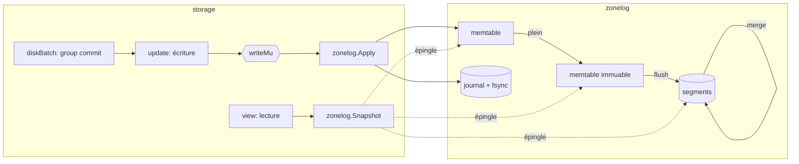

# Stockage et verrous

**Statut : actuel.** Code : `internal/zonelog`, `internal/storage`.
Règles : STORE-1, STORE-2, STORE-3, READ-1, SUM-4, HND-2, AUTH-4
([registre](../protocol/invariants.md)).

Un nœud a deux couches de stockage. **zonelog** est le moteur : un journal,
des memtables, des segments triés et des fichiers de payload. **storage** est
l'état durable du nœud par-dessus : records, permissions locales, tickets de
transfert, membership de routage, reçus et compteurs. Une transaction `storage` devient
exactement un lot `zonelog.Apply` : un seul fsync, tout ou rien.

## Lire

**Garantie (STORE-1).** Une lecture `storage` voit l'état d'un seul commit,
du début à la fin, même si elle lit en plusieurs pages. Elle ne prend pas
`storage.writeMu` et ne passe pas par le chemin de fsync.

Elle partage tout de même le CPU, le disque et des verrous internes avec
les écritures : `zonelog.mu` en lecture le temps de copier un morceau de
memtable, le verrou du cache de pages, celui des fichiers de payload.

**Mécanisme.**

- `Store.view` ouvre un `zonelog.Snapshot` (`internal/zonelog/snapshot.go`).
  Il épingle le seq visible, la memtable courante, la memtable immuable et la
  liste des segments.
- La memtable mutable est lue par morceaux de 1 024 lignes sous
  `zonelog.mu.RLock` (`memChunkIter`). La memtable immuable, les segments et les
  payloads sont lus **hors** de `zonelog.mu`.
- Une écriture qui remplace une clé garde l'ancienne version tant qu'un
  snapshot plus ancien peut la voir (`minVisible`).
- Un segment fusionné n'est fermé et supprimé qu'une fois fermés tous les
  snapshots ouverts avant la fusion (`retiredSegs`, filigrane `retiredAt`). Il
  en va de même pour les fichiers de payload que ces segments référencent.
- `Store.peek` lit sans snapshot : chaque lecture voit le dernier commit. Il ne
  sert qu'aux contrôles répétés sous verrou.
- Des sommes de zones lues ensemble passent par `Store.OpenZoneSums`, qui
  épingle une seule version : le total d'un résumé et les corrections qu'on
  en retire voient les mêmes lignes (SUM-4). Elle s'ouvre sous `Tree.Mu`
  (ouvrir ne fait aucune I/O), mais ne s'y ferme pas : fermer un snapshot peut
  supprimer des segments fusionnés. Une version remplacée sous le verrou est
  mise de côté et fermée ensuite ; une flush ferme la sienne avant tout envoi
  réseau.

**Coût à surveiller.** Un snapshot laissé ouvert longtemps retient les segments
fusionnés sur le disque et les anciennes versions en mémoire. Aucune métrique
n'expose encore l'âge du plus vieux snapshot.

Les parcours consultatifs `PlanningStats`, `PlanningTotals` et
`InventoryRegion` partagent `scanZonePages`. Ils ouvrent un snapshot par page :
les zones d'une page voient un commit, mais deux pages peuvent voir des commits
différents. Les compteurs ne sont mis en cache que si la première et la dernière
page portent la même version. Les inventaires clients stricts conservent leurs
propres contrôles de filigrane.

## Erreurs de lecture

`txReader` retient la première erreur de `Get` ou `ScanWith`, même si un helper
comme `value` ou `any` ne peut pas la retourner. `Tx.run` la rend à la frontière
de lecture ; `Tx.commit` refuse les écritures en attente, y compris si l'erreur
survient pendant la comptabilité. Une erreur de disque ne devient donc pas une
valeur absente ni un simple refus d'autorité.

Les tests `TestTransactionReadErrorAbortsPendingWrites`,
`TestReadBoundariesReturnIgnoredIOErrors`,
`TestScanDoesNotClearItsCallbacksReadError` et
`TestCommitRejectsReadErrorDuringUsageAccounting` injectent ces pannes et
vérifient l'absence de commit.

## Écrire

**Garantie (STORE-2, HND-2).** Les transactions d'écriture `storage` sont
appliquées une à la fois, dans l'ordre de `writeMu`. Une écriture acquittée est
sur disque (fsync) et visible des lectures commencées après l'ACK.

**Mécanisme.**

1. **Admission** (`internal/storage/write_batch.go`, `diskBatch.submit`). Une
   écriture est refusée avec `ErrWriteOverload` dans trois cas : plus de 4 096
   écritures en attente, plus de 64 Mio en attente, ou une tête de file qui
   attend depuis plus de 2 s. Ce dernier seuil n'est pas l'algorithme CoDel,
   c'est un plafond d'âge.
2. **Group commit** (`diskBatch.run`). Les écritures en attente sont prises par
   groupes de 256 au plus, après une fenêtre de 2 ms si le groupe n'est pas
   plein. Ce sont les valeurs par défaut d'`Open` ; `Options.BatchSize` et
   `BatchDelay` les changent. Un groupe forme **une** transaction `update`. Si un rappel échoue, la
   transaction est annulée, le groupe est rejoué sans lui, puis il est rejoué
   seul.
3. **Transaction** (`Store.update`). Elle prend `writeMu`, valide et écrit dans
   un `Tx`, compte l'usage, puis appelle `zonelog.Apply`.
4. **`zonelog.Apply`**. Il prend `zonelog.mu` en exclusif et lit la version
   précédente de chaque clé (memtable, puis segments : de l'I/O disque sous ce
   verrou). Il place les lignes, relâche `mu`, puis fait le fsync sous
   `syncMu`. Les lignes deviennent visibles après le fsync.

`writeMu` reste tenu pendant tout ce chemin, fsync compris. C'est le group
commit qui amortit ce coût.

**Ingestion bulk.** Elle tient `writeMu` pendant toute l'écriture du segment
(`storage/bulk.go`) : les écritures attendent pour toute sa durée. Le segment
est publié (`Bulk.Commit`), puis le reçu et les compteurs dans une seconde
transaction. Entre les deux, une lecture voit les lignes avec les compteurs
d'avant. Après un crash à cet endroit, `reconcileBulk` recompte à l'ouverture.

**Contre-pression.** Quand la memtable dépasse 1/16 du budget mémoire et que la
précédente n'a pas fini son flush, `Apply` attend ce flush (`flushed.Wait`).

## État de contrôle local

Le document de contrôle conserve les droits natifs installés, le compteur durable,
les opérations en cours et leur phase, le déplacement éventuel et le digest de
membership. La membership est rangée sous sa propre clé ; une clé de version
(sha256 du document de contrôle) accompagne ses mutations. Les états par zone,
les données de staging et les renvois de lecture restent dans leurs propres lignes.
Il n'y a plus de graphe d'ancêtres d'autorité à fusionner.

Les caches de documents décodés, de membership pure et de snapshot du dernier
contrôle évitent de reconstruire cet état à chaque mutation de données.
`causalCacheMu` ne couvre que le décodage et la préparation du snapshot local,
jamais un appel réseau ou une autre transaction. Le test
`TestLocalTicketsWritesUseCachedLocalPermissions` exerce 65 membres et 100
écritures sans relecture du document de contrôle dans cette fenêtre.

`MergeMembership` prend le `mergeMu` local, distinct de `writeMu`. Il prépare
la fusion compacte hors du verrou d'écriture, puis compare le digest de
membership au commit. Une évolution concurrente provoque une nouvelle
préparation. Il ne valide ni signatures ni historique des droits et n'installe
aucune permission. Les écritures utilisateur n'appellent pas cette fusion.

Les fences et installations restent des transactions locales durables.
`CoalesceLocalRights` prépare aussi sa géométrie hors `writeMu`, puis compare
la version de contrôle sur 32 octets ; une concurrence rend `ErrNotReady` et
la maintenance reprend plus tard. Aucun pair ne doit répondre pendant ce commit.
Voir [les permissions locales](../protocol/local-permissions.md) et la
[qualification](../protocol/local-permissions-verification.md).

## Formats refusés à l'ouverture (STORE-3)

`Open` refuse avec `ErrUnsupportedFormat` un disque dont l'état de contrôle a
une forme que ce build ne lit plus (`refuseRetiredShapes`,
`storage/zone_table.go`) :

- un document de contrôle sans clé de version ;
- un document qui porte Knowledge en ligne, sans digest (avant E5b) ;
- un transfert dont les états de zone sont dans le document (`Zones`, avant
  XFER-KEYS-1) ;
- des lignes de l'ancien journal de découverte `causal-migration-zones`.

Le seul format de ce remplacement est `indexus-flat-4`. Les formats précédents,
y compris `indexus-flat-3` de l'étape à checkpoints, sont refusés ; il n'existe
aucun mode de compatibilité ou de migration implicite.

Un disque écrit par ce build n'a aucune de ces formes. Le refus est voulu : un
disque ancien n'est jamais lu de travers ; il faut repartir d'un répertoire vide
et réimporter. Test : `TestOpenRefusesRetiredControlShapes`.

## Carte des verrous

Seuls les verrous du chemin de données sont listés.

| Verrou | Protège | Coûteux sous ce verrou | Qui attend | Annulation |
| --- | --- | --- | --- | --- |
| `zonelog.mu` (RW) | memtables, liste des segments, seq visible, collections | **exclusif** : repli de préparation si la version a changé (lectures possibles) ; la préparation froide normale se fait hors verrou sur snapshot puis est revalidée ; écriture du manifeste lors d'une publication de flush ou de merge, ou d'une nouvelle collection. **Partagé** : copie d'un morceau de memtable | `Apply`, `Snapshot()`, les morceaux de scan | aucune |
| `zonelog.snapMu` | snapshots ouverts, segments retirés | rien | `Snapshot()`, `Close()` | — |
| `zonelog.syncMu` | écriture du journal et fsync | **fsync** | les commits suivants : un seul fsync par groupe | — |
| `zonelog.valMu`, `cache.mu` | fichiers de payload ouverts, cache de pages | rien (verrous feuilles) | lectures | — |
| `storage.writeMu` | ordre des transactions d'écriture, ingestion bulk | **tout le commit, fsync compris** ; **toute une ingestion bulk** | toutes les écritures, `MergeMembership` à son commit | aucune une fois pris |
| `storage.mergeMu` | une fusion de membership locale à la fois | préparation/validation des records compacts hors `writeMu` | les autres fusions de membership | aucune |
| `storage.causalCacheMu` | un seul décodage par version de contrôle | décodage et validation | les lecteurs d'une version pas encore en cache | — |
| `storage.shadowMu`, `ownedSeqsMu` | base des copies shadow (réplication), cache des seqs possédés | ouverture paresseuse de la base shadow | réplication | — |
| `diskBatch.mu` | file d'admission | rien | `submit` | contexte, avant l'admission seulement |
| `summary.Tree.Mu` | contributions reçues, arêtes, résumés | ce qu'une flush calcule sous lui ; la revérification du holder (`ChildHolderCurrent`) | `AcceptBatch`, `Fold` | — |
| `summary.RefreshMu`, `InventoryMu` | une réconciliation ou un fold d'inventaire à la fois | un fold | les suivants | **oui** (`ctxMutex`) |
| `mesh.handoffRights` | une opération sur un même droit natif d'entrée | appels réseau de ce droit, hors transaction disque | les seules opérations sur la même entrée ; les droits indépendants ne partagent pas ce verrou | contexte de l'admission |
| `mesh.routeMu` | indices de route d'entrée (WRITE-HINT-1) | rien (verrou feuille, jamais tenu pendant un appel) | les relais d'entrée | — |
| `mesh.cutoverMu` | barrières de cutover par zone | rien ; l'attente se fait hors verrou, 500 ms au plus | — | contexte |
| `membershipWire.mu` | scheduling, reçus de version par pair et travail en vol | rien ; pas d'appel réseau sous ce verrou | contrôle asynchrone seulement | fermeture des workers |
| `membershipWire.mergeMu` | une fusion de membership à la fois | fusion de membership, hors chemin de validation des données | autres fusions de contrôle | contexte avant fusion |

**Ordre des verrous.** Un verrou de la gauche peut être tenu quand on prend
celui de droite, jamais l'inverse :

- `zonelog.syncMu` → `zonelog.mu` → `zonelog.snapMu`
- `storage.mergeMu` → `storage.writeMu` → `zonelog.mu`
- `summary.Tree.Mu` → lectures `storage` (ouverture de snapshots ; leur fermeture se fait hors de `Tree.Mu` quand l'appelant le peut)

`valMu`, `cache.mu` et `mesh.routeMu` sont des feuilles : on n'en prend aucun autre en les
tenant.

## Mesures

`docs/benchmarks/storage-stall-2026-11-16.md` et `docs/benchmarks/elasticity.md`
racontent les blocages qui ont mené à ce découpage. Ces mesures sont antérieures
aux snapshots MVCC (23 novembre 2026). Les campagnes locales suivantes sont
séparées dans [la reprise](../benchmarks/recovery-cleanup-20261125.md) et
[le nettoyage/contrôle](../benchmarks/cleanup-scale-20261125.md) ; elles ne
qualifient pas à elles seules la capacité AWS.

## Couverture d'une lecture rafraîchie (READ-1)

Une page d'inventaire associe ses records et ses `Receivers` dans un même
snapshot. La clôture d'un transfert ne peut donc pas supprimer d'une page
ancienne le receveur qu'il faut encore interroger. Le mesh conserve la copie
la plus récente d'une même zone, ou échoue si un receveur nécessaire manque.
Le test déterministe est
`TestQueryKeepsEarlierACKWhenTransferCompletesDuringSourceInventory`.

Cette correction (`6a3015e`) est distincte de SUM-4, qui prend les sommes
locales d'un total et les sommes à en soustraire sur une seule version. Un
snapshot local cohérent ne promet pas la fraîcheur des contributions
distantes ni un instant commun à tous les disques. Les erreurs de lecture
retenues par `txReader` empêchent aussi qu'une panne soit traitée comme une
absence et qu'une transaction commite sur cette base (`031fa1a`).

**Évolution locale pendant la revue du 24 novembre.** `summary.Owned` copie
les contributions reçues sous `Tree.Mu`, puis calcule les sommes locales hors
de ce verrou, via `valueWithIncoming`. La cohérence SUM-4 du snapshot local
reste nécessaire ; déplacer l'I/O ne rend pas les contributions distantes
fraîches. Ce changement est intégré dans `b2d3dea`, distinct du commit `6a3015e`.

## Membership et commit local

Le blob de membership est immuable par digest à l'intérieur du store. Les six
producteurs de changements le publient avec sa référence dans la même transaction.
Une fence ou un reçu local ne sérialise, ne hache et ne compare plus tous les
membres. Les exports publics restent détachés. Les droits, opérations et exceptions
actuels ont encore un coût de copie/sérialisation local ; aucun fsync n'est retiré
pour obtenir une mesure plus faible. Voir la qualification et ses limites.
