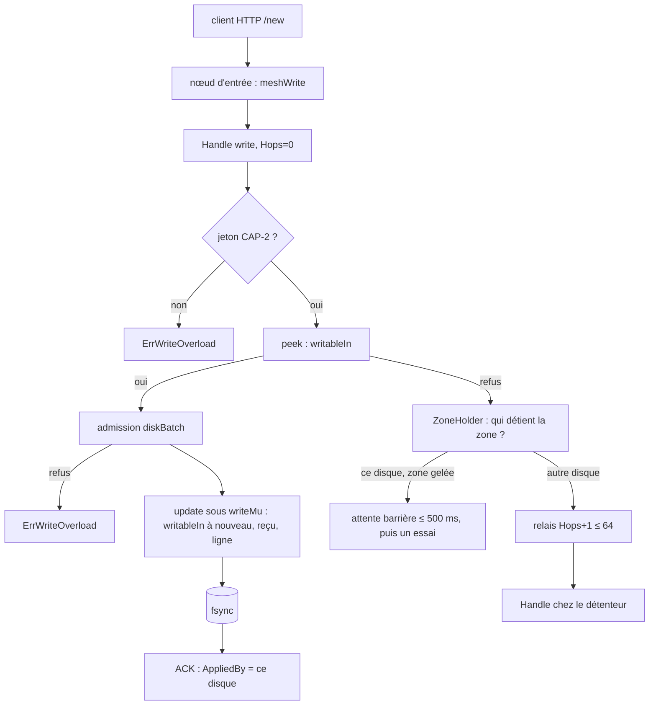

> Archive de la carte antérieure à la passe de nettoyage du 25 novembre 2026.
> Le fonctionnement actif est décrit dans [la carte actuelle](../architecture/chemin-ecriture.md).

# Chemin d'une écriture

> **Transition du 25 novembre 2026.** Cette carte décrit le prédécesseur.
> Les appels liés aux preuves globales, aux checkpoints et au placement doivent
> être relus avec le [nouveau contrat](../protocol/local-permissions.md).
> La [qualification](../protocol/local-permissions-verification.md) distingue
> remplacement branché et qualification distincte ; aucun ancien benchmark ne qualifie celle-ci.

**Statut : actuel.** Code : `indexus/mesh_runtime.go` (`meshWrite`, `routeOf`),
`internal/mesh/service.go` (`Handle`), `internal/mesh/write.go` (`handleWrite`),
`internal/storage/apply.go`,
`internal/storage/permission.go`, `internal/mesh/replicate.go`,
`internal/mesh/fallback.go`.
Règles : AUTH-3, HND-2, RETRY-1, ROUTE-1, FWD-1, FWD-2, KNOW-LAZY, CAP-2,
STORE-2 ([registre](../protocol/invariants.md)).

## Vue d'ensemble

`Handle` valide les métadonnées et prépare la réponse. `handleWrite` exécute
l'admission, l'application locale, l'attente de cutover, le relais et la
réplication. Le remboursement d'admission est protégé par `defer` ; avant un
relais il est fait immédiatement, sans attendre le RPC distant.

## Autorité et ACK

**Garantie (AUTH-3, HND-2).** Seul le disque qui détient l'autorité installée
acquitte une écriture. Une écriture acquittée est durable (fsync) et survit aux
transferts et aux redémarrages.

**Mécanisme.**

- `ApplyRecordContext` fait d'abord un contrôle bon marché (`peek` +
  `causalWritable`). Une zone gelée ou détenue ailleurs ne fait donc pas la
  queue derrière le disque.
- L'écriture passe ensuite l'admission ([stockage](../architecture/stockage-et-verrous.md#écrire)).
- Le prédicat `writableIn` est refait **dans** la transaction du commit, et
  c'est lui qui décide. Le contrôle préalable ne suffit jamais à acquitter.

**Rejeu (RETRY-1).** Une écriture porte un `RequestID`. Son reçu est commité
avec elle. Un rejeu du même `RequestID` est reconnu (`Applied=false`) et
n'écrit pas deux fois, y compris après un transfert ou un redémarrage
(`TestCompactReceiptsPreserveOldResultsAcrossHandoffAndRestart`).

## Routage

Le nœud d'entrée ne choisit pas de destination à l'avance. Il essaie
localement, puis, sur `ErrNotOwner`, `ErrFrozen` ou `ErrNotReady`, résout le
détenteur avec `ZoneHolder` : les grants du réplica, plus les lignes de
transfert que ce disque détient. Ensuite :

- **Le détenteur est ce disque et la zone est gelée** : si un cutover local est
  en cours, l'écriture attend sa fin, au plus 500 ms. Elle relit alors le
  détenteur et réessaie une fois. Si la zone est encore gelée (l'annulation
  n'est pas encore durable, par exemple), l'erreur est renvoyée.
- **Le détenteur est un autre disque** : l'écriture lui est relayée
  (`Hops+1`, au plus `MaxWriteHops` = 64) par `exchangeWrite`, ou d'abord au
  disque désigné par l'indice de route (ci-dessous). Ce relais ne
  porte ni n'attend Knowledge : la réponse est compacte, et un retard de
  Knowledge déclenche un échange en arrière-plan
  ([knowledge.md](../architecture/knowledge.md#transport-entre-pairs)).

**Indice de route au nœud d'entrée (WRITE-HINT-1, statut : actuel).** Pour
une écriture reçue d'un client (`Hops == 0`), le nœud d'entrée retient, par
zone exacte, le disque qui a appliqué la dernière écriture relayée
(`AppliedBy`), s'il diffère du détenteur résolu. L'écriture suivante lui est
envoyée directement. Pendant un join, le receveur écrit une zone dès son
installation, alors que la Knowledge du nœud d'entrée ne le nomme qu'à la fin
du transfert : sans indice, chaque écriture passait par la source jusque-là.

- **Garantie** : l'indice route, il n'autorise rien. Le disque visé n'accepte
  que ce que `writableIn` permet chez lui, et relaie le reste à son propre
  détenteur. Un indice faux coûte un relais.
- **Mécanisme** : un échec vers le disque indiqué efface l'indice et envoie
  l'écriture au détenteur résolu dans le même appel, une fois (`RequestID` rend
  ce nouvel essai idempotent ; pas de nouvel essai sur `ErrWriteOverload` ni
  contexte annulé). Un ACK du détenteur résolu efface l'indice. Cache borné à
  4096 zones (éviction en anneau), structure partagée avec `mesh.Writer`
  (`zoneRoutes`). Une écriture déjà relayée (`Hops > 0`) n'utilise pas
  d'indice.
- **Mesure** : voir [knowledge.md](../architecture/knowledge.md#coût-et-effet-mesuré-sur-les-écritures).

**Ce que l'écrivain apprend.** La réponse d'une écriture relayée porte
`AppliedBy`, le disque qui l'a appliquée. Avec `AsyncKnowledge`, elle ne porte
plus de Knowledge. Deux sortes d'écrivains s'en servent :

- **les clients HTTP** : l'adaptateur en tire `X-Indexus-Owner` et
  `X-Indexus-Owner-Cell`, l'adresse du propriétaire et **sa cellule entière**
  dans la vue du nœud d'entrée. Un client en mode `direct`
  (`cmd/experiment -route direct`) écrit ensuite directement à ce
  propriétaire ;
- **le client Go `mesh.Writer`** : il retient `AppliedBy` pour la zone exacte
  `(collection, location)`, dans un cache borné. Aucun binaire de ce dépôt ne
  l'utilise ; seuls des tests le font
  ([../protocol/write-routes.md](../protocol/write-routes.md)).

Limite connue : pendant un transfert, la cellule du receveur couvre aussi des
zones qui ne lui ont pas encore basculé. Un client `direct` les envoie au
receveur, qui les relaie à la source jusqu'à la fin du transfert.

## Débit simulé (CAP-2)

Quand `WriteRate` est fixé (expériences), une écriture **appliquée** sur ce
vnode consomme exactement un jeton. Toute sortie qui n'applique rien ici le
rend, une seule fois : refus, relais ou échec. Un essai local après un cutover
garde le jeton qu'il tient (`TestCAP2_LocalRetryAfterAbortedCutoverSpendsOneToken`).

## Réplication (si activée)

Avec `ReplicateWrites`, le propriétaire, après le commit, pousse le seq de la
zone vers les autres membres de `R(z)` (`replicateWrite`) :

- `Durability=replicated` : un autre membre a acquitté dans `ackTimeout` ;
- `Durability=local` : aucun n'a acquitté à temps. L'écriture reste
  acquittée : elle est durable chez le propriétaire.

Les répliques sont choisies dans la vue locale du propriétaire. Une vue en
retard peut donc choisir un membre ancien. `replicated` reste vrai dans ce cas,
puisqu'une autre machine a bien la copie.

## Écritures de secours (fallback)

**Statut : partiellement branché.** Le **receveur** existe. Un membre de `R(z)`
accepte une `fallback-write` seulement s'il soupçonne le propriétaire, faute de
heartbeat depuis `SuspectTimeout`. Il l'écrit dans un journal séparé, à part de
l'état du propriétaire (`ApplyFallback`).

Quand la réplication est activée, la maintenance envoie les heartbeats et
répare : le propriétaire fusionne ces entrées (`RepairAllFallback`, fusion
convergente). Les lectures dégradées superposent ce journal à la copie shadow
(`KindDegradedRead`, READ-1).

En revanche, **aucun code de ce dépôt n'émet de `fallback-write`** : seuls des
tests en envoient (`TestREPL4_FallbackWriteRepairAndConvergence`,
`TestFaultUnderLoad_PartitionCrashRestartZeroLostACKs`). Le contrat du
propriétaire unique (AUTH-3) ne couvre que les écritures autoritatives. Une
entrée de secours n'est pas un ACK du propriétaire, tant qu'elle n'a pas été
réparée chez lui.

## Pistes (statut : historique)

Les trois pistes sont faites : les écritures et les lots gelés ne passent
plus par `carryFull` ni par la fusion de Knowledge (9590cba, d5e9873), ce qui a
supprimé le plafond de 2 s, et le nœud d'entrée suit l'indice de route par
zone (WRITE-HINT-1) : la première écriture directe au nouveau vnode arrive
environ 60 ms après sa première installation, au lieu de la fin du join
([mesure](../architecture/knowledge.md#coût-et-effet-mesuré-sur-les-écritures)).

Ce que l'indice ne change pas : la latence de queue pendant le join (p99 et
max) vient des attentes de gel des lots (XFER-LOT-1), pas du saut de plus.
