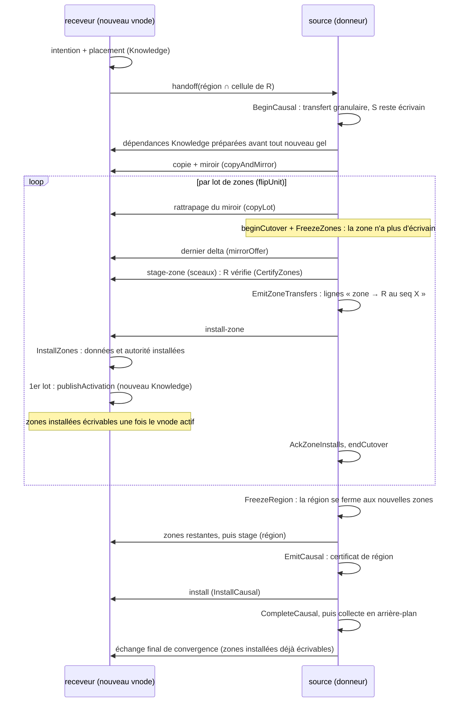

# Transfert de zone

**Statut : historique — instantané du protocole à checkpoints avant son remplacement.** Code : `internal/mesh/service.go` (`Join`, `handoffLocked`,
`transferZones`), `internal/mesh/flip_units.go` (`flipUnit`, `cutoverLot`),
`internal/storage/causal_zone.go`, `internal/storage/zone_states.go`,
`internal/storage/permission.go`.
Règles : AUTH-1, AUTH-3, ZONE-1, ZONE-2, MIG-1, HND-2, HND-4, FWD-1, ACT-1,
XFER-KEYS-1, XFER-LOT-1, READ-1 ([registre](../protocol/invariants.md)).

Ce document remplace, pour le fonctionnement actuel, `protocol/handoff.md`,
`protocol/transfer-units.md`, `protocol/transfer-state-keys.md` et
`protocol/zone-transfer-scope.md`. Ceux-ci restent la trace de leurs
décisions.

## Qui peut écrire une zone

**Garantie (AUTH-1, AUTH-3).** Sur le chemin normal d’autorité, à tout instant,
au plus un disque peut acquitter une écriture sur une zone donnée : celui
qui détient l’autorité installée.

**Mécanisme.** Un seul prédicat décide, `Store.writableIn`
(`storage/permission.go`). `ApplyRecord` le refait dans la transaction même du
commit. Il combine quatre entrées :

1. **Placement** : le vnode de ce disque est actif et placé sur ce disque
   (`placed`), sinon `ErrNotReady` ou `ErrNotOwner`.
2. **Détenteur** (`zoneHolder`) : le grant de la région dans le réplica, surchargé
   par un transfert de zone ouvert que ce disque détient en lignes
   (XFER-KEYS-1). Ce doit être ce disque, sinon `ErrNotOwner`.
3. **Gel sortant** (`outgoingFrozen`) : la zone est gelée par un transfert que
   ce disque envoie, sinon on renvoie `ErrFrozen`.
4. **Installation** : le jeton du grant est installé ici, ou bien ce disque a
   installé la zone pour l'opération exacte qui la lui transfère. Sinon
   `ErrNotReady`.

`readableIn` et `flippedIn` sont des variantes de lecture de ce même prédicat :
une zone gelée reste lisible à la source, et le receveur peut nommer les zones
déjà basculées.

## Le join, piloté par le receveur

### 1. Ouverture

Le receveur publie son intention et son placement, calcule sa cellule XOR et
appelle chaque donneur dont un grant recouvre cette cellule (`Service.Join`).

Côté source, `BeginCausal` ouvre un transfert **granulaire**. La source reste
propriétaire et accepte les écritures. `handoffMu` sérialise les handoffs
donneurs sur un même disque.

### 2. Copie à chaud

`copyAndMirror` copie les zones. Les écritures arrivées pendant la copie sont
répercutées chez le receveur.

### 3. Bascule par lots (XFER-LOT-1)

`transferZones` range les zones par profondeur décroissante, puis par chaleur
dans une même profondeur, en lots
dont la taille s'adapte (`adaptiveUnit`) à une **cible** de 150 ms de gel par
lot. Ce n'est pas une borne. Sans surcharge de configuration, le lot démarre à
64 zones et peut varier de 16 à 2 048, avec une cible de copie de 1 Mio
et une limite de 8 Mio par zone. Les enfants passent avant leur parent.
Pour chaque lot, `cutoverLot` :

- a. **rattrapage** (`copyLot`) : le miroir est complété jusqu'à ce que le retard
  soit petit, sans geler. Les dépendances causales sont préparées une fois par
  tentative, avant tout nouveau gel dans `handoffLocked` : les étapes c à e
  utilisent ensuite des réponses compactes, sans
  attendre Knowledge ([knowledge.md](../architecture/knowledge.md#transport-entre-pairs)) ;
- b. **gel** : `beginCutover` pose une barrière, puis `FreezeZones` gèle les
  zones. À partir de là, ces zones n'ont plus d'écrivain ;
- c. **dernier delta et sceaux** : `mirrorOffer`, puis `stage-zone` avec les
  sceaux. Le receveur vérifie chaque sceau contre sa copie (`CertifyZones`). Si
  elle diffère, la source envoie le snapshot gelé lui-même, que le receveur
  vérifie contre le même sceau ;
- d. **cession** : `EmitZoneTransfers` écrit, en lignes chez la source, le fait
  « zone → receveur au seq X ». Une cession émise ne s'annule plus
  (`TestAbortCausalRefusesAfterEmit`) ;
- e. **installation** : `install-zone` chez le receveur (`InstallZones`), qui
  peut désormais écrire ces zones. À son premier lot, il publie son activation
  (`publishActivation`) ;
- f. **fin** : `AckZoneInstalls` chez la source, puis `endCutover`.

La période sans écrivain d'une zone va de b à e. `transferProgress.hold` en
garde le maximum par transfert, et le log « zone cutover » le donne par lot.

### 4. Clôture régionale

Après deux passes, `FreezeRegion` (ou `ForceFreezeRegion` si de nouvelles zones
continuent d'apparaître) ferme la région aux zones nouvelles. Suivent :

- les zones restantes (`transfer-stragglers`) ;
- `SealCausalRegion`, puis `stage` des zones non basculées une à une ;
- `EmitCausal` (le certificat de région), puis `install` (`InstallCausal`) ;
- `CompleteCausal`, et la collecte des octets de la source en arrière-plan
  (`CollectTransferred`).

La clôture régionale porte une responsabilité que les lots n'ont pas. Une zone
née pendant le transfert entre dans le `MigrationSet` (`noteMigrationZone`), et
le certificat de région consomme le grant de toute la région, zones absentes
comprises (ZONE-2, MIG-1). C'est pour cela que les deux chemins, par lots et par
région, coexistent.

## Ce que voient les écritures pendant le transfert

Le chemin détaillé est dans [chemin-ecriture.md](../architecture/chemin-ecriture.md).

| Moment | Une écriture sur la zone… |
| --- | --- |
| avant le gel du lot | est appliquée par la source, puis répercutée au receveur |
| zone gelée (b → e) | reçoit `ErrFrozen` à la source ; si la barrière du même processus est active, elle attend au plus 500 ms, puis relit le détenteur |
| zone cédée, pas encore installée | est relayée vers le receveur, qui ne peut pas encore l'acquitter : elle est refusée (`ErrNotOwner` ou `ErrNotReady`, au plus `MaxWriteHops` relais), et le client réessaie |
| zone installée chez le receveur | est relayée par la source au receveur (un saut de plus) tant que l'écrivain route par l'ancienne vue |
| après l'activation, pour l'écrivain qui la connaît | arrive directement au receveur si l'écrivain route par cellule (`WriteTarget`). Le nœud d'entrée, lui, résout la zone (`ZoneHolder`) et continue d'envoyer à la source jusqu'au certificat de région |

## Reprises

Voir la matrice [pannes.md](../architecture/pannes.md). Les tests qui la vérifient :

- `TestGranularHandoffResumesFrozenAndLostACKWithoutOverwritingLiveWrites`
- `TestMirrorConcurrentWritesAndLostInstallACK`
- `TestCausalZoneCycleAndCrashCuts`
- `TestCollectTransferredFinishesAfterRestartBeforeFinalStep`

## Mesures

[../benchmarks/elasticity.md](../benchmarks/elasticity.md) et
[../benchmarks/ramp.md](../benchmarks/ramp.md) donnent les mesures AWS (avec
leurs commits). `TestMeasuredGranularHandoff` (`internal/mesh`,
`INDEXUS_HANDOFF_MEASURE=1`) mesure, en local, le délai entre le gel et l'ACK
d'installation, ainsi que le premier ACK chez le receveur.

## Lire pendant le transfert (READ-1)

La copie gelée du donneur peut être plus ancienne que les écritures déjà
acquittées au receveur. Une lecture rafraîchie demande donc aussi les zones
basculées aux receveurs nommés par le donneur. Depuis `6a3015e`, la page de
données et cette liste sont lues dans **le même snapshot MVCC**. Sinon, une
fin de transfert entre deux lectures pouvait effacer la liste et faire
renvoyer avec succès un ancien total.

`TestQueryKeepsEarlierACKWhenTransferCompletesDuringSourceInventory` force
cette fin de transfert pendant la lecture : il attend tous les records si
le receveur répond, et une erreur explicite s'il est partitionné. Cela ne
transforme ni les résumés en lectures fraîches, ni le fan-out en snapshot
global instantané.

## Disponibilité, routage et fin de join

Distinguer l'installation et l'activation qui rendent un lot écrivable, sa
première écriture appliquée, son premier ACK client, l'apprentissage de sa
route directe et la fin du join. Le commit `6a3015e` ne contenait pas encore
l'indice au nœud d'entrée. La mise à jour locale du 24 novembre
(`bfb8432`, WRITE-HINT-1) partage désormais `zoneRoutes` avec `mesh.Writer` : un ACK
relayé apprend `AppliedBy` pour la zone exacte. Le cache est borné à 4 096
entrées, réservé au premier saut ; un indice en échec est abandonné et le
détenteur résolu est réessayé une fois, sans nouvel essai sur surcharge ou
annulation. L'indice n'autorise aucune écriture. Les mesures locales sont
datées dans [knowledge.md](../architecture/knowledge.md), séparément des résultats AWS.

`install_to_first_write` se termine à la première application locale, avant
l'ACK client ; il dépend aussi de l'arrivée d'une écriture sur la zone.
Aucune nouvelle campagne AWS ne découle des tests locaux de ces corrections.
