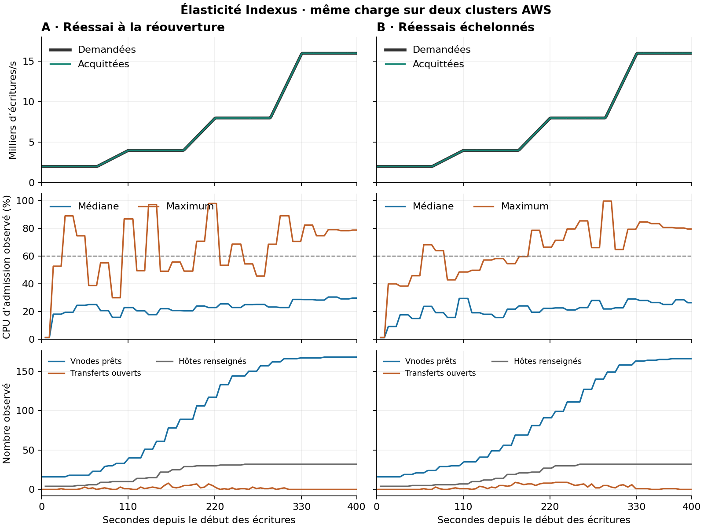
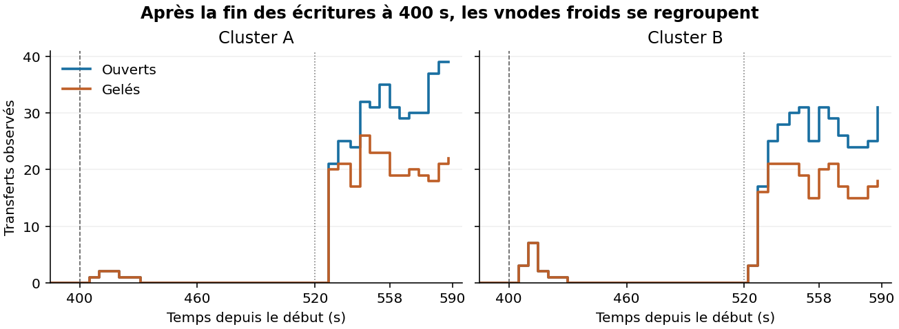

# Quand un renfort commence-t-il à écrire ?

Nous avons comparé deux règles de réessai du provisioner sur AWS. La règle A, conservée sur `main`, permet à un donneur de réessayer dès la réouverture de l’API. Avec B, le premier donneur peut réessayer à la même date. Les autres étalent leurs tentatives. Les deux règles vérifient la capacité et la réservation à chaque appel.

Deux clusters indépendants ont reçu la même séquence pseudo-aléatoire de 2 956 272 écritures. Chacun partait de quatre hôtes i4i.xlarge et de seize vnodes, avec une limite de 32 hôtes, un générateur c6i.4xlarge, le routage direct H3, une cible CPU de 50 % et un seuil de split de 50 écritures/s par vnode. La charge doublait de 2 000 à 16 000/s, avec des paliers de 70 s et des rampes de 40 s. La graine 1226634160 fixe les données. Les identités des vnodes, les délais EC2 et l’ordre concurrent des requêtes diffèrent entre clusters. Chaque variante a tourné une fois. Les révisions testées sont `d869cf4` et `6912139`.



| Sur les 400 s d’injection | A · réouverture | B · étalement |
|---|---:|---:|
| Demandes envoyées par les donneurs | 3 940 | 3 568 |
| Couples distincts donneur et cible demandée | 316 | 309 |
| Démarrages confirmés suivis d’une écriture observée | 152 | 150 |
| Première écriture sous 30 s, parmi les demandes suivies au moins 30 s | 85/316 | 67/308 |
| Première écriture sous 120 s, parmi les demandes suivies au moins 120 s | 148/230 | 138/196 |
| De la demande à la première écriture, médiane / p95 parmi les servies | 27,9 / 94,6 s | 34,4 / 120,3 s |
| Du retour du démarrage à la première écriture, p95 parmi les servies | 1,78 s | 2,90 s |
| Au palier 16 000/s, latence client p50 / p95 / p99 | 4,096 / 8,192 / 16,384 ms | 4,096 / 8,192 / 16,384 ms |
| Au même palier, p99 depuis l’arrivée prévue | 32,768 ms | 32,768 ms |

La majeure partie de l’attente observée précède la confirmation du placement. L’étalement économise 372 appels. Les refus explicites pour attente de capacité passent de 2 786 à 2 359, ceux liés au délai de l’API de 967 à 1 019. Le gain de service mesuré dans les 30 premières secondes favorise A. À 120 s la fraction favorise B, avec 113 demandes trop tardives pour être évaluées en B et 86 en A. La seconde entière dans les journaux du provisioner limite la précision des durées mesurées depuis le retour du démarrage. Le compteur historique de première écriture pouvait inclure un rejeu acquitté. Le journal de charge de chaque essai contient des identifiants uniques. Sur un processus neuf, les prochains essais enregistrent aussi la première installation entrante durable et la première écriture nouvellement appliquée. Sur un processus redémarré, une installation idempotente peut constituer sa première observation locale.

## Ce qui bouge entre les machines

Nous avons suivi le même vnode donneur avant et après un placement distant. Nous avons retenu les fenêtres disposant d’au moins deux observations entre 25 et 5 secondes avant le placement et entre 20 et 40 secondes après. Les placements multiples du même donneur dans cette fenêtre sont exclus. Sa part du trafic se calcule en divisant ses écritures appliquées par les ACK client observés au même instant. Les débits absolus peuvent augmenter pendant une rampe même quand la part du donneur baisse.

| Placements observables | A | B |
|---|---:|---:|
| Part du trafic du vnode donneur en baisse d’au moins 20 % | 99/99 | 109/112 |
| Part du trafic de sa machine en baisse d’au moins 20 % | 48/99 | 61/112 |
| Variation médiane du CPU de la machine donneuse | +2,68 points | +2,93 points |
| Variation médiane du CPU de la machine receveuse | +6,04 points (80 paires) | +5,17 points (97 paires) |

Un split divise environ par deux la part du vnode donneur dans ces cohortes. D’autres vnodes du même hôte continuent à recevoir des écritures ou à transférer des zones. Une décision de placement gagne donc à suivre les deux machines et à vérifier leur charge une fois la copie passée. Le CPU d’admission du graphique est le maximum de la charge physique mesurée et de la somme des charges des vnodes ramenée aux cœurs de l’hôte. La médiane et le maximum portent sur les machines renseignées à chaque instant.

La réservation actuelle de 1,75 cœur sur un hôte de quatre cœurs utilise 43,75 points sur les 60 autorisés pour recevoir. Une machine à 20 % peut donc être refusée même sans réception en cours. Nous avons rejoué ce calcul sur les observations avec disque, mémoire et emplacement disponibles, sans réception en cours. Avec 1,75 cœur, 70 des 554 observations A et 66 des 461 observations B passent le contrôle CPU. Avec 1,5 cœur, ce seraient 187 et 183. Les observations se répètent sur les mêmes machines. Elles mesurent des occasions de placement, sans prédire le CPU qu’aurait coûté le placement supplémentaire. Au dernier point de l’injection, les 32 hôtes de chaque cluster dépassaient 16,25 %. Aucun ne proposait de réception, alors que seuls deux hôtes A et un hôte B dépassaient 60 %. Ce veto explique comment une flotte disposant de CPU libre cesse de placer des vnodes.

## Modèle de placement par paire

Le simulateur peut maintenant réserver les deux machines physiques d’une copie pendant la même durée, quel que soit leur rôle. Deux paires disjointes progressent en parallèle. Une décision utilise les ressources projetées aux deux extrémités. Les démarrages EC2 gardent un délai partagé. La variante de comparaison ajoute aussi un délai partagé entre les admissions de vnodes. Dans les deux cas ce délai débute au retour du hook, ce qui laisse plusieurs appels déjà en vol progresser.

Avec 64 demandes, huit donneurs, huit receveurs immédiatement disponibles, un hook de 250 ms et des copies de 4 à 7 s, le p95 simulé d’admission passe de 63 à 56 s et la médiane des appels de 605 à 271 sur 100 graines. Avec deux receveurs prêts, puis six démarrages de 20 s, le p95 passe de 83 à 75 s avec les mêmes six boots. Quand le trafic se concentre sur un seul donneur, le p95 passe seulement de 205,5 à 199 s. La disponibilité du donneur reste déterminante. Ce modèle emploie des coûts de copie synthétiques et des réservations toujours libérées. Une implémentation réelle devra distinguer refus, perte de réponse et reprise d’une opération déjà décidée.

## Après la fin des écritures



L’injection se termine à 400 s. Sur A les compteurs indiquent zéro transfert ouvert à 400, 502 et 522 s. Les premiers appels de regroupement à froid apparaissent vers 527 s, après les deux minutes de calme requises. À 558 s, chacun des deux clusters a 31 transferts inter-hôtes ouverts. Sur A, seuls trois des 31 identifiants sont encore visibles dix secondes plus tard et tous ont quitté la liste à 578 s. La hauteur de la courbe traduit une succession d’opérations. Les derniers compteurs enregistrent 10 regroupements terminés et 48 abandons sur A, et 9 regroupements terminés et 58 abandons sur B.

Si chaque machine ne pouvait participer qu’à une copie à la fois, combien de vagues faudrait-il pour la cohorte de 558 s ? Une arête relie les deux hôtes de chaque opération. Sur A, l’hôte le plus sollicité touche quatre arêtes, ce qui impose au moins quatre vagues. Un ordonnancement en trouve exactement quatre. Sur B la borne et le nombre obtenu sont tous deux cinq. Dix opérations de A et huit de B sont déjà en phase d’acquisition d’un créneau de copie. Le graphe décrit des opérations ouvertes à plusieurs phases. Il ne mesure ni leur durée ni le nombre de copies physiques actives.

## Contrôles des données

Chacun des deux journaux contient exactement les 2 956 272 écritures de charge attendues après vidage, sans identifiant dupliqué ni emplacement répété. Les sondes de lecture/écriture ajoutent 1 811 entrées sur A et 1 900 sur B. Un contrôle stratifié retrouve 512 ACK de charge sur chaque cluster. Un second audit natif, lancé 80 s après la charge, relit 512 entrées tirées du journal, compare les totaux des 257 collections et vérifie les propriétaires sur 170 vnodes A et 173 vnodes B. Les totaux correspondent aux journaux sondes incluses. Le contrôle observe zéro zone doublement détenue. Les deux scénarios ont atteint le délai réservé à l’export et au nettoyage (code 124) avant de produire leur audit exhaustif. La relecture individuelle de toutes les clés reste à qualifier. Après export, nous avons vérifié la terminaison des 66 instances, la disparition des 66 volumes EBS et la suppression des réseaux, buckets et accès créés pour ces essais.

## Reproduire

Les deux archives d’épisodes ne contiennent que des identifiants de donneurs renumérotés, des horodatages relatifs, les motifs de réponse et les dates de service. La fenêtre de 400 s est vérifiée sur le journal d’injection. Les commandes s’exécutent dans ce répertoire.

```sh
python3 demand_control.py aws-pair-a.json.gz aws-pair-b.json.gz
python3 host_pair_admission.py --seeds 100
python3 receiver_margin.py /chemin/steps-1/machines.jsonl --start EPOCH_DE_DEBUT --seconds 400 --plateau 70 --ramp 40
```

Le [rejeu des essais précédents](demandes50.md) explique comment sont traitées les demandes trop récentes pour lesquelles la fenêtre d’observation est incomplète.
