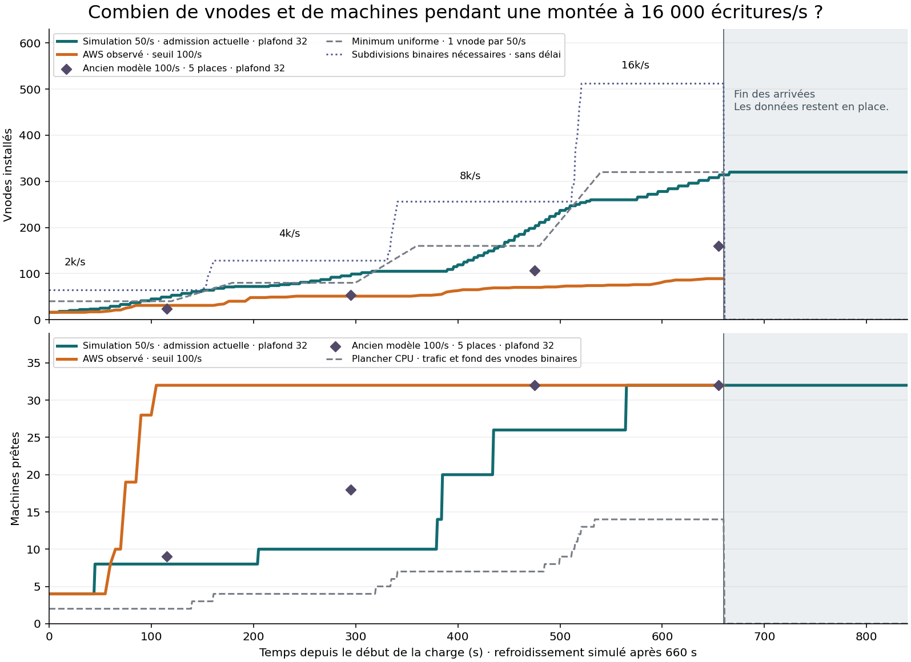

# Dimensionner le seuil de 50 écritures/s par vnode

À 16 000 écritures/s, 320 vnodes suffisent si chacun reçoit exactement 50/s. En partant des seize parts de trafic effectivement observées dans les dix premières secondes, le découpage répété de la part de chaque vnode en deux moitiés demande **512 vnodes** pour les ramener *tous* sous le seuil. On peut déjà répartir efficacement une partie du trafic bien avant le dernier split. Le nombre d’hôtes répond à deux questions différentes : combien peuvent servir le trafic stabilisé, et combien permettent aux copies de se terminer pendant la rampe ?



## Capacité d’une machine à 50 %

L’ajustement robuste porte sur 736 observations de 29 hôtes i4i.xlarge (4 vCPU) lors du run à 100/s. Les vnodes doivent être présents aux deux sondes machine, sans réception, join, transfert ouvert, gel ou changement de compteurs de transferts aux sondes vnode de la fenêtre. Les compteurs d’écritures appliquées utilisent un intervalle de 9 à 16 s, terminé au plus 6 s avant la lecture CPU. D’éventuelles activités brèves entre sondes ou des tâches annexes restent possibles. Le CPU à vide médian sur 294 relevés vaut 0,10 %.

**CPU hôte (%) ≈ 0,10 + 0,538 × nombre de vnodes + 0,02459 × écritures appliquées/s.** Un vnode à 50/s mobiliserait 1,77 point CPU en moyenne dans cet ajustement. Le budget de 50 % correspond donc à environ **1 412 écritures/s, soit 28 vnodes à ce débit**. Si le trafic est déjà réparti entre 512 petits vnodes, 14 machines constituent le plancher CPU agrégé à 16k/s. Avec 320 vnodes exactement chargés à 50/s, le plancher serait de 12 hôtes.

Le débit maximal d’un hôte dans les observations sélectionnées est 1 767/s, mais aucun n’héberge plus de cinq vnodes. En retirant chaque machine tour à tour, le calcul de densité donne 21 à 35. L’erreur absolue médiane du modèle CPU est 4,0 points et le p90 16,1 points. L’estimation indépendante via CPU des processus donne 25 vnodes à 50/s ; elle omet les autres consommateurs de l’hôte. Le dimensionnement à 28 sert à choisir où étendre les mesures. Au bilan, la mémoire de travail, les tables de connexions, les E/S, la réplication, les résumés et les pics par zone peuvent faire baisser la densité bien avant 28. Le compteur des processus ne permet pas d’attribuer le CPU machine resté inexpliqué pendant la saturation AWS.

## Combien de relief arrive à temps ?

La simulation reprend les arrivées par seconde (arrondies à l’écriture/s), quatre hôtes initiaux et les seize fractions observées. Le donneur cède une part de son trafic progressivement pendant la copie. Un hôte est un seul point d’extrémité de copie à la fois. Les demandes sont déclenchées par le débit du vnode. Le receveur distant admissible le moins chargé est sélectionné. Le simulateur connaît ses parts réelles ; les erreurs de routage, consultations, contentions et handoffs avortés sont omis. Les vnodes nouvellement installés peuvent dépasser cinq par machine. Les séries de données occupées, de RAM et de disque ne sont pas simulées au-delà des densités qualifiées.

Les 68 joins AWS observés jusqu’à leur fin ont un âge médian de 9,72 s et un p90 de 35,29 s. Le processus receveur consomme 5,64 s CPU en médiane, une charge moyenne de 0,63 cœur (p90 0,95 cœur), et son pic de RSS échantillonné médian est 105 Mio. Cette charge totale du receveur pendant son démarrage inclut une partie du traitement ordinaire ; l’imputer entièrement en supplément dans le modèle est conservateur. La consommation du donneur par copie n’est pas isolée dans ces mesures. Les variantes utilisent 8 ou 15 points CPU côté donneur, hypothèses explicites. Le délai entre commande et disponibilité d’une nouvelle machine est testé à 30, 45 et 75 s, sans le confondre avec le temps de copie.

Le scénario illustré budgétise des voies de copies en plus de la capacité stable. Tous les 5 s, il estime combien de splits manquent au débit courant, puis les voies nécessaires pour résorber ce retard en 120 s, bornées par les hôtes donneurs distincts. Il réserve la capacité CPU correspondante et deux extrémités par voie. Cette politique expérimentale reste plafonnée à 32 machines. Une copie démarre seulement si le donneur peut en assumer le coût estimé sous 60 % et si le receveur conserve la marge d’admission actuelle de 1,75 cœur. Après installation la charge prévue du receveur doit rester sous 50 %. Le simulateur part sans machine de réserve et n’anticipe pas la rampe suivante.

| Palier, temps de lecture | Vnodes minimaux uniformes | Vnodes nécessaires par division binaire | Simulation 50/s, vnodes / machines | AWS 100/s, vnodes actifs / machines | Ancien modèle 100/s, vnodes / machines |
| --- | ---: | ---: | ---: | ---: | ---: |
| 2 000/s, 115 s | 40 | 64 | 49 / 8 | 31 / 32 | 24 / 9 |
| 4 000/s, 295 s | 80 | 128 | 95 / 10 | 51 / 32 | 53 / 18 |
| 8 000/s, 475 s | 160 | 256 | 198 / 26 | 70 / 32 | 107 / 32 |
| 16 000/s, 655 s | 320 | 512 | 308 / 32 | 89 / 32 | 160 / 32 |

L’ancien modèle est repris tel que publié dans `reserve-growth.csv`, cinq slots, plafond 32, sans anticipation, copies et boots de 30 s. Les observations AWS sont les sondes les plus proches des quatre temps, à deux secondes près. À 660 s, AWS affiche 91 processus, 89 vnodes actifs, 32 hôtes. L’audit du générateur indique 4 876 204 ACK sur 4 876 204 offres après drainage. L’écart de l’ancien modèle à 655 s — 160 vnodes prévus contre 89 actifs — empêche de lire le nouveau modèle comme un engagement de performance.

## Effet de la marge de copie et du refroidissement

| Hypothèses du scénario au terme de la charge | Vnodes installés à 660 s | Copies encore en cours | Hôtes prêts | Vnode le plus chargé | Pic de la file synthétique avec service plafonné à 50 % |
| --- | ---: | ---: | ---: | ---: | ---: |
| Calcul de capacité stable seul, 45 s de boot, copies 10 s | 82 | 0 | 14 | 255/s | 1 747 840 |
| Capacité et voies de copies, mêmes durées, admission actuelle, 32 hôtes max. | 314 | 6 | 32 | 64/s | 0 |
| Mêmes voies et durées, budget de réception hypothétique de 0,63 cœur, 32 hôtes max. | 450 | 16 | 32 | 61/s | 0 |
| Même budget hypothétique, 24 hôtes max. | 418 | 12 | 24 | 62/s | 0 |
| Copies de 36 s, boot 75 s, fractions 60/40, admission actuelle, 32 hôtes max. | 182 | 15 | 32 | 223/s | 15 288 |

Dans le premier cas, les donneurs chargés franchissent le seuil permettant de commencer une copie. Des machines peuvent ainsi rester disponibles tandis que les zones chaudes restent sur les mêmes hôtes. Dans la variante longue, l’alimentation du goulot d’étranglement dure moins longtemps, les paliers sont servis avec davantage de travail en attente de split. Le pic de la file d’écritures est un calcul fluide séparé, par hôte : arrivées moins débit disponible pour son CPU. La série utilise deux plafonds de service conventionnels, 50 et 100 %, sans rétroaction de la file sur le placement. Ce compteur synthétique ne prédit ni ACK, ni p99, ni perte. Le budget hypothétique de 0,63 cœur utilise la médiane d’un processus receveur ; le p90 du pic échantillonné vaut 1,55 cœur. Il ne justifie pas d’abaisser la protection actuelle.

À 660 s, 198 vnodes du scénario central avec voies dépassent encore 50/s. À l’arrêt du générateur, les six copies engagées finissent, puis le nombre se stabilise à 320 vnodes sur 32 machines pendant le refroidissement jusqu’à 840 s. La baisse des écritures éteint la demande de split. Les vnodes portent toujours l’autorité et les données. Une baisse du nombre physique d’hôtes réclamerait en plus un mécanisme de regroupement ou de migration vers des voisins, avec preuve d’installation, maintien des lectures, puis extinction des hôtes vides. Ni l’AWS observé sur la fenêtre injectée ni le rejeu ne qualifient ce scale-in.

## Reproduire depuis le dépôt

Depuis la racine du dépôt, avec Python 3.10 ou ultérieur, NumPy, SciPy et Matplotlib installés, exécuter cette commande. Le répertoire de sortie peut être neuf.

```sh
python3 docs/benchmarks/aws-placement-100-20261127/granular50/projection.py --output /tmp/indexus-granular50 --series
```

La commande recalcule l’ajustement robuste, les dix variantes sur 841 secondes (de 0 à 840 inclus) et écrit `resultats.csv`, `granularite50.pdf`, `granularite50.png`. L’option `--series` ajoute `simulation.csv`, avec les 8 410 états projetés. À 660 s, la ligne `50-voies-strict` de [resultats.csv](resultats.csv) doit donner 314 vnodes, 32 hôtes et six copies engagées. À 840 s, elle donne 320 vnodes et 32 hôtes.

Les entrées publiées proviennent des agrégats du run `aws-place-100-direct-1127`. [calibrage.csv](calibrage.csv) conserve les temps relatifs de mesure, les effectifs, le trafic et le CPU hôte hors mouvement observable. Les identifiants d’hôte sont pseudonymisés. [campagne.json](campagne.json) contient le CPU à vide médian, les quantiles du coût receveur, les seize valeurs de trafic initiales groupées par machine et les changements du débit offert par seconde. Ces derniers restent valables jusqu’au prochain changement. [observations100.csv](observations100.csv) conserve les effectifs de vnodes actifs et d’hôtes pendant la charge. [ancien-modele.csv](ancien-modele.csv) donne les quatre points du scénario antérieur. Le rejeu utilise ces cinq fichiers locaux.

Vérification sur Python 3.12.7, NumPy 1.26.0, SciPy 1.15.3 et Matplotlib 3.10.8. Dans un répertoire contenant seulement le programme et ses cinq entrées, les 8 410 lignes régénérées sont identiques, colonne par colonne, aux valeurs du premier calcul sur les traces. Le tableau de synthèse et les deux figures reproduisent aussi les fichiers publiés sur cette installation.

Le run à 50/s a ensuite permis de [mesurer le délai des demandes et de tester le modèle sur la seconde moitié de la rampe](demandes50.md).
