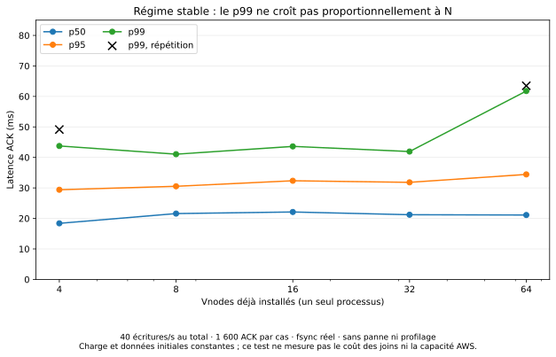

# D'où viennent les 964 ms ?

Mesures locales du 25 novembre 2026, production `9d3b750` (identique à `a6e918b`
pour les chemins mesurés). Cette passe modifie le laboratoire et son observation,
pas le protocole. Harnais conservé dans `1cc783d`. Elle complète [le rapport précédent](cleanup-scale-20261125.md)
et [l'analyse des coûts de contrôle](../design/scaling-and-control-costs.md).

## Le nombre initial ne mesure pas 64 nœuds en régime stable

Les **964 ms sont le p99 de tous les ACK pendant une montée de 4 à 64 nœuds**,
avec pannes injectées et profils CPU/mutex/blocages. Ce n'est ni une durée de gel,
ni une attente de membership, ni un p99 propre à un réseau de 64 nœuds installés.
Le p99 depuis l'arrivée prévue était 1 744 ms : la file du générateur compte aussi.

À `t=20,127 s`, ce run avait offert 3 751 écritures pour 3 206 ACK :
**128 requêtes en vol (tous les workers) et 417 en file**, seulement quatre joins
terminés et onze façades déclarées prêtes. Pendant les dernières secondes de la
rampe, cinq à sept nœuds acquittaient réellement ; la répartition était inégale.
Être présent dans la membership, être prêt sur un morceau et porter sa part de
charge sont trois états distincts.

En associant approximativement les incréments d'ACK aux échantillons d'une
seconde : 346 ACK surviennent avec 4–7 nœuds prêts, 3 811 avec 8–15, 853 avec
16–31, 1 350 avec 32–63 et 139 avec 64. Trois ACK finaux sont hors du dernier
échantillon. Cette reconstruction ne permet **pas** de recalculer les p99 par
population : l'ancien run ne conservait pas les temps individuels.

Cette surcharge explique une partie du résultat, mais pas tout : un nouveau
run avec joins à seulement 40 écritures/s reproduit une latence élevée.

## Comparaison contrôlée : même charge, réseau installé

Chaque cas commence après installation des droits de placement, préchargement de
2 048 zones au total et dix secondes de chauffe. Charge constante **40 écritures/s
pour tout le réseau**, quatre phases de dix secondes : 1 600 ACK par cas.
Fsync réel, délai disque simulé de 1 ms, écritures HTTP directes, 256 collections,
nouvelles zones ; aucune panne, aucun profil CPU/mutex/blocages, aucun dump de
piles. Les RPC entre pairs ont un délai simulé de 1 ms ; le premier RPC client
ne passe pas par ce délai. Tous les stores partagent le même SSD physique.

| Vnodes installés | p50 ACK | p95 ACK | p99 ACK | p99 depuis arrivée prévue |
| ---: | ---: | ---: | ---: | ---: |
| 4 | 18,39 ms | 29,40 ms | 43,75 ms | 47,62 ms |
| 8 | 21,59 ms | 30,53 ms | 41,06 ms | 44,49 ms |
| 16 | 22,11 ms | 32,34 ms | 43,61 ms | 47,57 ms |
| 32 | 21,21 ms | 31,83 ms | 41,93 ms | 45,36 ms |
| 64 | 21,11 ms | 34,43 ms | 61,76 ms | 79,72 ms |

Une répétition dans l'ordre inverse, 64 puis 4, donne **63,49 puis 49,14 ms** au
p99. Cela confirme un surcoût à 64 dans ce banc, pas une croissance proportionnelle
à N. Deux répétitions aux extrémités ne constituent pas un intervalle de confiance.



Tous ces audits retrouvent les ACK sans duplication d'écrivain. Aucun échec,
retry, relais, ACK dégradé, transfert ouvert ou gel observé pendant la charge.
Les 40 écritures/s ne qualifient ni la capacité maximale, ni le fonctionnement à
16 000/s sur AWS. Le coût des joins est volontairement exclu de ce tableau.

## Contrôle des ressources

Mac de 16 Go, huit CPU logiques ; `GOMAXPROCS=8`. Tous les vnodes sont dans **un
seul processus Go**, donc partagent aussi un ramasse-miettes. Les observateurs
externes tournent en série avec les cas, jamais deux laboratoires simultanés.
Les chiffres suivants portent uniquement sur la fenêtre d'écritures, pas sur le
boot ou l'audit :

| Vnodes | CPU hôte libre, minimum échantillonné | CPU du processus, maximum en cœurs | RSS maximum | Mémoire libre minimum | Swap sortant |
| ---: | ---: | ---: | ---: | ---: | ---: |
| 4 | 83,1 % | 0,27 | 48 Mo | 45 % | 0 page |
| 8 | 80,9 % | 0,38 | 81 Mo | 47 % | 0 page |
| 16 | 57,6 % | 0,45 | 82 Mo | 42 % | 0 page |
| 32 | 76,2 % | 0,56 | 138 Mo | 38 % | 0 page |
| 64 | 64,8 % | 0,61 | 243 Mo | 44 % | 0 page |

Le débit loopback maximal échantillonné reste inférieur à 15 Mbit/s dans cette
matrice. Ce n'est pas une mesure de capacité d'un NIC ni de QUIC distant. Le SSD
est rempli à environ 92 %, avec environ 35 Gio libres ; une sonde indépendante
`F_FULLFSYNC` donne des médianes de 5–6 ms et des maxima de 11–14 ms. Les cas
installés ne montrent donc pas de saturation persistante CPU/RAM/réseau, de swap
sortant ou de forte dégradation de cette sonde disque. L'échantillonnage CPU/RAM
hôte toutes les dix secondes n'exclut pas un pic sub-seconde.

## Les joins reproduisent le problème à faible charge

Run `dynamic-constant/dynamic-64-r1` : 8 192 zones préchargées comme dans l'ancien
run, dix secondes de chauffe, puis 40 écritures/s constamment pendant les joins,
sans panne ni profilage. Il termine en 486,3 s avec **19 295/19 295 ACK**, aucun
ACK manquant/dupliqué, aucun double écrivain et aucun gel restant après l'audit.
L'audit final inclut une réconciliation explicite du placement après la charge :
il ne prouve pas que tout le placement était optimal pendant les joins.

| Mesure | p50 | p95 | p99 | Maximum |
| --- | ---: | ---: | ---: | ---: |
| ACK depuis départ worker | 106,79 ms | 447,78 ms | **873,12 ms** | 4 791,92 ms |
| ACK depuis arrivée prévue | 112,63 ms | 457,15 ms | 876,88 ms | 4 793,25 ms |
| Temps cumulé dans les RPC client | 87,81 ms | 419,22 ms | 843,82 ms | 4 685,40 ms |

Six écritures sont retentées ; zéro échec final, zéro ACK dégradé. Le p99 de
backoff est zéro. Dans le centile le plus lent, les RPC représentent en moyenne
1 208,85 ms, le backoff seulement 3,22 ms. La file d'entrée observée reste vide,
avec un retard de lancement p99 de 35,06 ms. Le coût est donc essentiellement
**dans le traitement des RPC**, pas dans une temporisation client de deux secondes.
82,5 % des ACK finaux sont directs : le placement souhaité reste un indice,
et des zones neuves vont encore chez une source qui les relaie pendant les joins.

| Nœuds prêts observés au départ | ACK | p99 ACK |
| --- | ---: | ---: |
| 4–7 | 241 | 437,21 ms |
| 8–15 | 2 050 | 875,96 ms |
| 16–31 | 4 875 | 908,30 ms |
| 32–63 | 10 792 | 875,57 ms |
| 64 | 1 294 | 546,63 ms |

Quarante-trois départs précèdent le premier échantillon. L'état prêt est observé
à la seconde et peut être périmé. Ces cohortes suivent une même histoire : elles
ne constituent pas cinq expériences indépendantes avec taille seule variable.
Le p99 élevé apparaît avant 64, puis baisse lorsque les joins s'achèvent.

### Ce run est aussi dégradé : ne pas l'utiliser comme référence matérielle

Le premier swap sortant pendant la charge apparaît vers 90 s. Sur la fenêtre,
53 384 pages sortent (environ 834 Mio pour les pages de 16 Kio de cet hôte).
Le minimum de CPU hôte libre descend à 9,27 %, le processus atteint 5,58 cœurs ;
la sonde fsync passe à 9,84 ms de médiane et 25,20 ms au p99.

Entre le premier et le dernier échantillon, environ **67,36 s de pauses GC
stop-the-world sur 480,95 s** : 14 % du temps mural, contre environ 0,4 % pour
les cas installés. La mémoire disponible à un instant donné ne suffit pas à
exclure cette perturbation. Les 64 vnodes partagent ce GC ; cela synchronise
artificiellement leurs pauses et peut amplifier les attentes de leurs mutex.
Les pauses existent déjà avant le premier swap. Ni le GC, ni le disque, ni les
verrous ne sont isolés causalement par cette observation : on ne peut pas leur
attribuer individuellement les 873 ms, ni prédire le p99 de 32 machines EC2.

## Reproduction réduite et profil des allocations

Le scénario dynamique à **16 nœuds**, mêmes 8 192 zones et 40 écritures/s,
reproduit **p50/p95/p99 = 99,75/498,39/811,82 ms**. Les 3 863 écritures sont
acquittées et l'audit passe, sans gel restant. Le CPU hôte garde au moins 42,37 %
libres aux points mesurés ; RSS maximum 216 Mo, mémoire libre minimum 42 %, zéro
swap sortant pendant la fenêtre (236 pages entrantes). On reproduit donc une
forte latence sans épuiser CPU ou RAM. Le disque partagé reste un facteur : la
sonde `F_FULLFSYNC` donne 11,89 ms de médiane, contre 5–6 ms à charge installée.

Les pauses GC représentent **17,74 s sur 94,85 s**, soit 18,7 % du temps mural.
Le profil d'allocations échantillonné par défaut, vidé en fin de test, estime
**74,3 Gio alloués cumulés** (pas simultanément en RAM), sur le test complet,
préparation et audit inclus. Répartition des allocations propres aux fonctions :

| Fonction | Part des octets alloués |
| --- | ---: |
| `segment.readPage` | 30,7 % |
| `valFile.frame` | 17,0 % |
| `Snapshot.spans` | 9,1 % |
| initialisation du décompresseur flate | 7,6 % |
| `bufio.NewWriterSize` | 5,8 % |

En attribution **cumulative imbriquée**, `FreezeZones` porte 19,1 %,
`CollectTransferred` 16,5 %, `Tree.ExportPage` 13,7 %, et tous les chemins
`updateCausal` 46,3 %. **Ne pas additionner ces pourcentages.** Le problème
concerne donc aussi les scans et snapshots dans les transactions de transfert,
pas uniquement la diffusion de membership. `FreezeZones` appelle
`liveSnapshot` dans `updateCausal`, sous sérialisation des commits du disque ;
le nettoyage relit aussi le stockage depuis ses transactions. Ce profil ne
reconstitue pas la contribution exacte à chaque ACK lent.

Le budget du store est ici **2 Mio**, expressément petit pour le laboratoire,
contre **256 Mio par défaut dans `zonelog.Open`**. La memtable a 128 Kio ; le
cache commence à 256 Kio et peut tomber à 32 Kio lorsque les index prennent leur
part. Un bloc de valeurs peut faire 64 Kio. Le cache conserve au moins une entrée,
mais ce budget peut provoquer des évictions répétées entre pages, index et valeurs.
La RAM libre du Mac n'augmente pas automatiquement ce budget local. Ainsi, une
machine globalement disponible peut néanmoins avoir des stores trop contraints.

### Contrôle du budget local : 2 Mio contre 32 Mio à 16 nœuds

Seul le budget de chaque store change ; ni les fences ni la validation d'autorité
ne sont modifiées. Ce paramètre augmente ensemble memtables et cache : cette
expérience ne sépare pas leurs contributions.

| Arrivées prévues dans les 40 premières secondes | 2 Mio/store | 32 Mio/store |
| --- | ---: | ---: |
| Écritures de la cohorte commune | 1 599 | 1 599 |
| p50 ACK | 142,81 ms | 102,60 ms |
| p95 ACK | 561,63 ms | 266,50 ms |
| p99 ACK | **936,68 ms** | **340,72 ms** |

Les 1 600 écritures du run entier à 32 Mio sont acquittées ; audit vert et zéro
swap sortant, RSS maximum 334 Mo. L'audit termine en 40,8 s, contre
99,7 s à 2 Mio ; la charge de traîne dépend de la durée des joins. Les p99 des
runs entiers n'ont donc pas exactement la même population : le tableau compare
la fenêtre d'arrivées commune, pas les 3 863 ACK contre 1 600 sans qualification.

Le GC occupe encore 8,16 % du temps mural entre échantillons à 32 Mio. Le profil
complet estime 16,8 Gio d'allocations cumulées ; c'est un run plus court, avec
moins d'écritures et de maintenance, donc pas une réduction normalisée par ACK.
Les allocations se déplacent vers `Snapshot.spans` (24,4 %) et
`memChunkIter.refill` (17,5 %). Le budget minuscule amplifie nettement le problème,
mais augmenter ce budget **ne suffit pas** : le p99 pendant les joins reste de
plusieurs centaines de millisecondes.

### Vérification à 64 nœuds et 32 Mio/store

Le même scénario dynamique à 64 nœuds termine en **140,0 s**, avec
**5 540/5 540 ACK**, audit vert, aucun gel restant et deux écritures retentées.
Le p50/p95/p99 du run entier vaut **88,95/258,87/419,37 ms** ; le p99 depuis
l'arrivée prévue vaut 438,18 ms. Sur les mêmes 1 599 arrivées initiales que le
contrôle à 16 nœuds, le p99 vaut **393,66 ms**, contre 340,72 ms à 16. À cible 64 identique, la cohorte initiale du run à
2 Mio avait un p99 de 794,58 ms : la même fenêtre passe donc de 794,58 à
393,66 ms. La vitesse de progression des joins change avec le budget ; ce ne
sont pas des topologies instantanées identiques à chaque arrivée.

Aucun swap sortant pendant la charge (425 pages entrantes), RSS maximum 908 Mo,
mémoire libre minimum 42 %, CPU hôte libre minimum échantillonné 20,12 %.
Le processus utilise au maximum 5,11 des huit cœurs. Le disque partagé travaille
davantage : médiane/p99 de la sonde fsync = 9,80/46,76 ms. Le GC occupe encore
10,18 % du temps mural. Ce n'est donc pas une mesure débarrassée de toute
interférence disque ou runtime, même sans saturation CPU/RAM soutenue.

Le profil estime **259,1 Gio alloués cumulés** sur le test complet. Cette fois,
les allocations propres sont dominées par `Snapshot.spans` (47,1 %),
`summary.ownerBelow` (21,9 %) et `bytes.Clone` (10,0 %). En attribution cumulative,
**`Tree.boundaries` représente 79,5 % et `Tree.ExportPage` 77,6 %**, chemins
imbriqués. Les lectures de pages et les décompressions ne dominent plus : le
plus gros coût restant est la **redécouverte des frontières de résumés**.

Le code précise pourquoi ce coût peut croître :

- `exportKeysFor` reconstruit la première page à chaque nouveau poll. Son cache
  sert aux pages suivantes, pas à partager cette découverte entre nouveaux polls.
- `exportKeysOf` marche dans les collections et leurs frontières **avant** le
  filtrage par parent destinataire : plusieurs pairs peuvent payer le même calcul.
- Pour chaque préfixe visité, `ownerBelow` repart de `view.Active` et construit
  des slices de candidats ; la marche appelle aussi `ZoneChildren`, qui calcule
  des informations plus riches que le seul inventaire de frontières recherché.

Un graphe dense de polls multiplie ainsi un travail de découverte qui dépend
lui-même de la vue et des préfixes. Le volume de membership n'est pas le bon
proxy pour tout ce travail. Ces profils et ce code démontrent l'amplification ;
ils ne suffisent pas à déduire une loi exacte N²/N³ ni le gain d'un correctif.

La priorité suivante est de **partager une découverte par version pertinente**,
avec invalidation sur topologie, droits installés et inventaire local, puis de
filtrer les destinataires ; utiliser le trie pour l'unicité d'un propriétaire
sous un préfixe ; demander un inventaire léger au stockage. Une première page ne
peut pas réutiliser indéfiniment une liste qui omet de nouvelles zones : il faut
préserver la fraîcheur et la qualification versionnée des pages. Il reste
également à raccourcir le travail sous sérialisation dans `FreezeZones` et le
nettoyage. **Aucun de ces correctifs de production n'est livré dans cette passe.**

## Ce qui est établi, ce qui reste à attribuer

1. **964 ms n'est pas un plancher à 64 nœuds.** Le régime installé est beaucoup
   plus rapide ; le run initial mélange surcharge, joints, pannes et profilage.
2. **Les joins restent coûteux à faible charge.** Le nouveau run invalide
   l'explication « c'est seulement le générateur ». Ce n'est pas un problème résolu.
3. **La maintenance périodique n'explique pas seule le surcoût stable.** À 64,
   la désactiver donne p50/p95/p99 = 21,92/42,62/66,49 ms, sans amélioration.
   Cette ablation conserve callbacks d'écriture, flush disque et routage client.
   Elle ne dit pas ce qu'il en est pendant les joins.
4. **La chauffe des collections est un facteur confondu.** Avec 256 collections,
   1 600 écritures réchauffent bien davantage chaque couple nœud/collection à 4
   qu'à 64. Le p50 de la dernière phase tombe à 9,18 ms à 4, reste à 20,97 ms
   à 64. `zonelog.collection` écrit durablement un manifeste lors du premier
   accès à une collection locale, depuis la section critique du moteur. C'est
   une piste vérifiable, pas encore une attribution mesurée par requête.
5. **Les profils historiques pointent des travaux concurrents concrets** :
   export des frontières de résumés, parcours `Children`, commits d'autorité,
   publication de segments et de manifests. Les délais cumulés de mutex ne
   sont pas des durées de gel. Il faut corréler les étapes de la requête lente,
   pas additionner les p99 de sous-étapes différentes.

Les profils d’allocations ont isolé les familles de travail dominantes ; il
faut maintenant mesurer les corrections ciblées, puis répéter avec des processus
séparés et une base matérielle sans pagination. Les
corrections éventuelles doivent viser le travail répété et les durées sous mutex,
sans retirer les fences ni déplacer un manifeste hors de l'ordre de durabilité.

## Reproduction et limites du harnais

Le test accepte maintenant `INDEXUS_LAB_NODES=4|8|16|32|64`, une charge constante,
une chauffe, les traces individuelles et une ablation de maintenance explicite.
`INDEXUS_LAB_FAULTS=0` coupait auparavant la partition et le disque lent, mais
**pas la perte du premier ACK d'installation** : ce défaut de test est corrigé et
couvert par un test déterministe avec `-race`. Les anciens runs « sans panne »
qui n'ont pas cette correction peuvent encore contenir cette perte.

Les traces sont enregistrées après les écritures ; l'horodatage de fin précède le
mutex de statistiques. Les métriques d'échantillonnage conservent leur propre coût
(scans de monitoring, `ReadMemStats`, sérialisation JSON) ; les compteurs de GC
n'incluent pas tous les arrêts possibles du runtime.

```sh
go test -c -o /tmp/indexus-latency.test ./indexus
python3 scripts/research/run-latency-scaling.py \
  --binary /tmp/indexus-latency.test --out /tmp/indexus-installed-matrix
python3 scripts/research/analyze-latency-scaling.py \
  /tmp/indexus-installed-matrix --out /tmp/indexus-installed-analysis
```

Les données brutes sont conservées hors dépôt dans
`outputs/latency-vs-nodes-20261125/` du workspace, avec le binaire, les snapshots
des sources, les manifestes de commandes/environnement et les observations
CPU/RAM/GC/loopback/fsync. La [synthèse chiffrée versionnée](latency-vs-nodes-20261125.json) accompagne ce
rapport. Les douze cas finaux totalisent 43 098 ACK et passent leurs audits.
`go test ./...`, build, vet et le test de l’interrupteur de pannes avec `-race`
qualifient les changements du harnais.
Aucun AWS n'a été lancé pour cette passe.

## Suite : corrections des répétitions

La [passe suivante](summary-work-20261125.md) suit les allocations jusqu'aux
boucles et aux lectures de valeurs inutilisées. Elle conserve les chiffres de
ce rapport comme mesures avant correction et sépare les passages intermédiaires
de la qualification finale.
