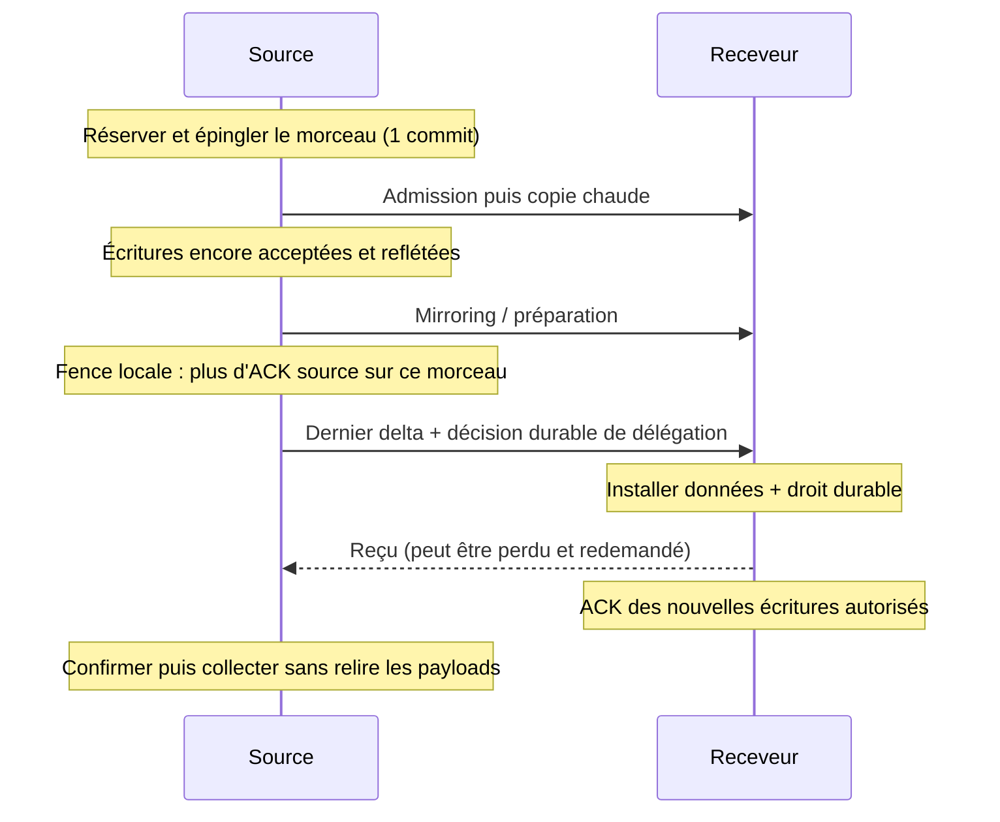

# Reprise des transferts et contention disque — 25 novembre 2026

## Ce qui était réellement bloquant

Le protocole courant ne diffuse plus un historique global de `Knowledge` pour
valider chaque écriture. La membership décrit les participants ; une adresse ou
une réponse de routage reste un indice. Le droit installé sur le disque décide
qui peut acquitter. Les reçus locaux de délégation restent nécessaires pour
reprendre une décision durable sans réactiver l'ancien écrivain.

Cela ne rendait pas toutes les opérations locales légères. L'analyse du run
`perm-16k-direct-after-1125-1702` et les reproductions disque ont identifié des
problèmes distincts :

1. **Une panne entrante empêchait la reprise sortante.** `Resume` retournait au
   premier échec de réparation entrante. Une opération sortante indépendante,
   déjà engagée, pouvait donc rester gelée. Les opérations sortantes passent
   maintenant d'abord ; les erreurs sont réunies après les réparations possibles.
2. **Découper puis réserver en deux commits laissait une fenêtre.** La maintenance
   pouvait refusionner le morceau choisi et son complément avant sa réservation.
   `BeginCausalPiece` découpe et épingle maintenant le morceau dans une seule
   transaction durable. Le complément reste disponible pendant la copie.
3. **Des propositions sans progrès tournaient trop vite.** Le join propose au plus
   une demande par donneur et par itération ; une réponse occupée n'est plus un
   progrès. Le délai de reprise croît de 20 à 500 ms et retombe après un succès.
4. **La suppression relisait les données qu'elle jetait.** Le nettoyage parcourt
   maintenant les clés et tailles encodées, y compris les tombstones opaques.
   La comptabilité exacte reste dans la transaction, sans décoder les payloads.
5. **Une mise à jour froide lisait sous le mutex du moteur.** Une préparation sur
   snapshot épinglé se fait maintenant hors de ce mutex. Au commit, le numéro de
   séquence est revérifié ; s'il a changé, le chemin existant recalcule sur l'état
   courant. Il n'y a pas de boucle optimiste sans borne.
6. **La clôture régionale conservait un second chemin de copie.** Elle ne doit
   consolider que les droits et reçus des morceaux déjà installés. Le staging
   régional refuse maintenant les snapshots ; les données passent par les lots,
   leur copie chaude, leur dernier delta et leur installation.

Les verrous de publication et la synchronisation durable restent nécessaires.
Ces changements ne prétendent pas supprimer toute attente disque, ni rendre un
fsync ou un pair indisponible instantané.

## Transfert attendu

Le donneur réserve atomiquement un morceau ; il copie pendant que les écritures
continuent et prépare le receveur. À la fence, il ferme les écritures locales de
ce morceau, transmet le dernier état et persiste sa décision. Le receveur installe
les données et le droit dans son propre état durable, puis peut acquitter. La
perte de sa réponse ne permet jamais au donneur de redevenir écrivain : il reprend
la même opération jusqu'à en connaître l'issue.

Une panne après la décision irréversible peut donc prolonger l'indisponibilité du
morceau. Aucun délai maximal n'est garanti avec un receveur durablement absent.
L'objectif est qu'une telle panne ne bloque pas les autres morceaux indépendants,
et qu'aucun travail proportionnel à l'historique ne s'ajoute après la fence.

## Routage direct : une autre horloge

L'ACK expose maintenant le morceau **effectivement installé**, et non la cellule
XOR théorique calculée à l'entrée. Avant consolidation, une autorité par point
n'annonce que ce point ; une autorité native peut annoncer son morceau, y compris
ses zones encore vides. Le cache du générateur conserve les compléments lorsqu'il
apprend une sous-région : apprendre Q/1 chez B ne doit pas effacer Q/0 chez A.

Les caches internes des nœuds et de `mesh.Writer` restent des indices par zone.
Ils peuvent donc encore faire un premier détour pour une nouvelle zone. Il faut
distinguer première installation, premier ACK du receveur, apprentissage de route
directe et clôture du join. Ces quatre moments ne sont pas un seul « gel ».

Le tableau de bord confondait aussi tentatives de relais et écritures réussies
relayées. Sur le run conservé, le ratio de tentatives était 46,2 %, mais **17,1 %
des succès observés** comportaient au moins un relais. Les nouvelles mesures
séparent les deux. Une version de membership absente est désormais inconnue,
et non une preuve que tous les participants sont synchronisés.

## Ce que la simulation avait manqué

Le laboratoire doit exécuter `RefreshContext`, donc la vraie reprise et la
coalescence, pendant les joins. Synchroniser uniquement la membership et les
résumés ne reproduisait pas la fenêtre découpage/réservation. Il doit aussi garder
les budgets par phase de production : ajouter un budget global de cinq secondes
au-dessus change artificiellement les opérations qu'il prétend vérifier.

Les caches de contrôle décodé étaient partagés entre disques dans le processus.
Avec 64 stores locaux, quelques slots globaux provoquaient une éviction permanente,
contrairement à un déploiement à un processus par vnode. Ils sont maintenant
bornés **par disque**. C'est une correction du laboratoire et de l'isolation ;
ce n'est pas une cause démontrée du problème AWS.

## Preuves et limites

Les tests déterministes exercent les transactions et prédicats de commit réels :
réponse d'installation perdue, nouvelle écriture déjà acquittée chez le receveur,
panne entrante indépendante, réservation concurrente avec coalescence, nettoyage
sans lecture des valeurs supprimées et préparation froide invalidée par une
écriture concurrente. Ils ne remplacent pas une preuve formelle du programme.

`ResumeIsolation.tla` isole l'ordonnancement de reprise : quatre états explorés,
propriété temporelle satisfaite. Le contrôle négatif `IncomingBlocksOutgoing`
retrouve le blocage attendu. Ce petit modèle ne modélise ni le moteur disque ni
la composition complète des lectures et des résumés.

Le microbenchmark de préparation d'une suppression de 128 valeurs flushées,
avec comptabilité, passe de 8,80–8,97 ms à 0,186–0,225 ms et de 49,8 Mo à 149 Ko
alloués par opération. **Il exclut le commit/fsync et ne mesure pas le gel client.**
Les scripts, contrôles et journaux conservent les essais en échec ; augmenter le
budget d'un laboratoire n'est pas présenté comme un gain de performance.

Le laboratoire `lab64-atomic-reservation-20261125`, exécuté sur `79ab98d`, a
terminé ses 64 joins en 268,8 s et l'audit en 270,8 s. Il démarre à quatre vnodes,
planifie jusqu'à huit joins simultanés et applique des paliers 50/100/200/400
écritures/s pendant cinq secondes chacun : **3 750 offertes, 3 750 ACK, zéro erreur,
zéro rejet, zéro ACK perdu ou dupliqué, zéro double écrivain et zéro gel final**.
Il conserve 8 192 zones préchargées ; les écritures visent de nouvelles zones.
Il n'y a pas de charge de fond après ces vingt secondes. Les joins continuent
ensuite sous maintenance. Une vérification de placement final explicite précède
l'audit : elle ne conditionne pas l'admission initiale du trafic.

Les latences ACK p50/p95/p99 de ce run sont 243/581/862 ms ; depuis l'arrivée
prévue, elles sont 252/588/867 ms. Une autre vérification de résumés a tourné
brièvement sur la machine pendant le run : ce résultat qualifie surtout la
correction de la reprise, pas une capacité ou une latence de production. Les
151 078 RPC incluent maintenance, découverte et reprises ; 2 121 échecs RPC
incluent les fautes injectées. Il reste donc du travail de mesure sur le coût
et la vitesse de convergence ; un audit vert ne prouve pas qu'ils sont optimaux.

Les essais précédents, limités à 240 s, ont expiré avant l'audit. Ils restent dans
les journaux et ne sont pas transformés en succès. Le budget final est de 600 s ;
le laboratoire a terminé avant cette limite. Aucun nouveau résultat de capacité
AWS à 16 000 écritures/s n'est revendiqué ici.

Voir [les garanties](../protocol/local-permissions.md),
[leur qualification](../protocol/local-permissions-verification.md) et
[les modèles](../../spec/handoff/README.md).

## Coût restant visible dans le laboratoire

Le détail des messages évite de rebaptiser tout le trafic « Knowledge ». En
volume JSON request+response cumulé, le run final compte environ :

| Classe | Appels | Volume décimal |
| --- | ---: | ---: |
| Membership | 14 097 | 193,0 Mo |
| Résumés, contributions | 10 982 | 358,4 Mo |
| Résumés, lectures | 108 602 | 108,7 Mo |
| Préchargement des lots | 2 233 | 23,8 Mo |
| Dernier staging des lots | 2 056 | 14,9 Mo |
| Installation des lots | 2 242 | 43,8 Mo |
| Consolidation régionale, stage + install | 354 | 0,325 Mo |

La membership finale vaut 12 886 octets dans cette fixture. Son transport envoie
encore un snapshot complet lorsque la version diffère, et une référence sinon :
**ce n'est pas encore un protocole de deltas de membres modifiés**. À forte activité
de joins, ces snapshots répétés restent coûteux. Ils sont séparés de l'autorité
et des écritures, mais leur bande passante et leur CPU ne sont pas gratuits.
Les résumés représentent ici le plus gros trafic cumulé. Le laboratoire exécute
une maintenance par vnode ; ces volumes ne sont pas une extrapolation AWS.

Les petits en-têtes de consolidation ne sont donc plus une seconde copie des
zones ; en revanche, réduire la membership différentielle et les lectures de
résumés est un chantier mesurable restant. Supprimer leur information sans
traiter la découverte des participants ou les lectures par région dégraderait la
vivacité ou l'exactitude. Cette passe ne revendique pas leur suppression.

## Vérifications de la passe finale

Sur le code de production `79ab98d` (les commits suivants documentent les
résultats), `go build ./...`, `go vet ./...` et `go test ./...` passent. Le
détecteur de courses passe sur les suites complètes `internal/storage`,
`internal/mesh` et `internal/zonelog`. Les 15 tests Python des mesures passent.
Le test temporel de regroupement des résumés a échoué lors d'un essai précédent
concurrent au lab64 ; il passe cinq répétitions finales et dans la suite complète.
Son seuil n'a pas été relâché ; les échecs antérieurs restent conservés.

L'audit de couches ne signale aucun import interdit. Le comptage exact entre
`157ed21` et `79ab98d` donne storage−28 lignes de production, zonelog+74, mesh+10,
façade−15 et cmd+9. Il s'agit d'un retrait de chemins et d'une correction de
concurrence, pas d'une forte réduction nette annoncée du code. Les nouveaux tests
et les modèles sont comptés séparément du code de production.

## Comparaison locale A/B/B/A

Même harnais, Go et `GOMAXPROCS=4`, fsync réel, RPC JSON en processus et RTT
synthétique de1ms ; avant `a15284d`, après `d269753` (production `79ab98d`).
Deux runs par révision ; quantiles des échantillons bruts réussis réunis, pas
moyenne des percentiles. Zéro erreur dans les quatre runs, aucun résultat
incomplet. Ce petit essai ne donne pas d'intervalle de confiance.

| Mesure (ms) | n par révision | Avant p50 / p95 / p99 | Après p50 / p95 / p99 |
| --- | ---: | --- | --- |
| Écriture, même zone | 800 | 6,13 / 9,76 / 13,64 | 6,18 / 10,37 / 12,99 |
| Écriture, nouvelles zones | 800 | 6,08 / 9,27 / 12,36 | 6,10 / 10,35 / 13,97 |
| Écriture, scénario join entier | 1 500 | 7,21 / 15,19 / 31,48 | 7,25 / 16,48 / 28,74 |
| Lecture fraîche après join | 600 | 10,90 / 12,28 / 15,45 | 10,99 / 12,42 / 15,21 |
| Lecture ordinaire après join | 600 | 10,90 / 12,25 / 13,85 | 10,95 / 12,29 / 14,47 |

Les p50 restent proches ; les queues ne s'améliorent pas uniformément. Sur les
nouvelles zones, le p99 augmente de1,62ms ; le p95 augmente aussi dans les trois
scénarios. Le p99 pendant le scénario de join baisse de2,73ms. Ces deux runs par
version ne suffisent pas pour attribuer chaque variation au code ni pour affirmer
une absence de régression. Les lectures fraîches vérifient le total final, pas
chaque identifiant ; l'audit64 vérifie séparément les ACK et leurs écrivains.

Le petit join (1024zones, payload1024octets, deux nœuds) dure1,66–1,75s avant
et1,73–1,85s après. Le premier ACK du receveur arrive à405–418ms avant,
387–417ms après. Ces timings ne démontrent pas un gain de vitesse du join.
Le p99 d'écriture depuis l'arrivée prévue vaut32,59ms avant et29,11ms après
sur le scénario join entier ; il inclut l'attente client et les réessais.

Le fuzzing `FuzzHandoffSchedule`, avec deux workers et dix secondes demandées,
passe sur1427exécutions, en conservant ses corpus intéressants. Les traces brutes
de la comparaison sont dans `latency-recovery-cleanup-20261125/`, à côté des
laboratoires, et la synthèse reproductible dans `scripts/research/compare-latency.py`.

## Vérification complémentaire : écrire jusqu'au dernier join

Le run `lab64-continuous-recovery-20261125` reprend les mêmes paramètres et
fautes avec `INDEXUS_LAB_TAIL_RATE=10`. Après les paliers, dix nouvelles écritures
par seconde continuent jusqu'à la fin des joins. Sur la même production
`79ab98d` (checkout `d269753`, seules les notes étaient en cours d'édition), il
termine ses 64 joins puis l'audit à **347,0 s** :

- **6 969 offertes, 6 969 ACK**, dont 3 219 écritures après les paliers ;
- zéro erreur finale ou rejet, zéro ACK perdu ou dupliqué ;
- zéro double écrivain, zéro écrivain manquant pour les ACK, zéro gel final ;
- latence ACK p50/p95/p99 **144/521/992 ms**, maximum **3 912 ms** ;
- depuis l'arrivée prévue : **161/635/1 010 ms** ;
- 185 285 RPC et 2 987 échecs RPC, y compris les fautes injectées et les reprises.

Les queues restent donc élevées sur cette machine unique. La charge maintenue
est faible ; il ne s'agit pas d'une preuve d'absorption continue à400/s ni16k/s.
Le run montre une fermeture des opérations sous écritures, pas une borne faible
du gel pour toutes les situations. Son temps total ne se compare pas comme une
accélération au run sans flux maintenu.

Un échantillonnage natif de trois secondes a été conservé et symbolisé avec
`go tool addr2line`. Il montre notamment des chemins `segment.seek`,
`cache.get`, `Snapshot.Children` et la découverte des frontières de résumés.
Les comptes de frames sont inclusifs, sans pourcentages CPU disjoints ; cet
échantillon ne prouve pas à lui seul un blocage de mutex Go. La lecture du cache
confirme que son mutex est relâché avant le chargement disque : ce bon pattern
a été conservé. Les logs de phases et de délais du writer restent disponibles
pour distinguer attente d'admission, durée de transaction et retour du receveur.
