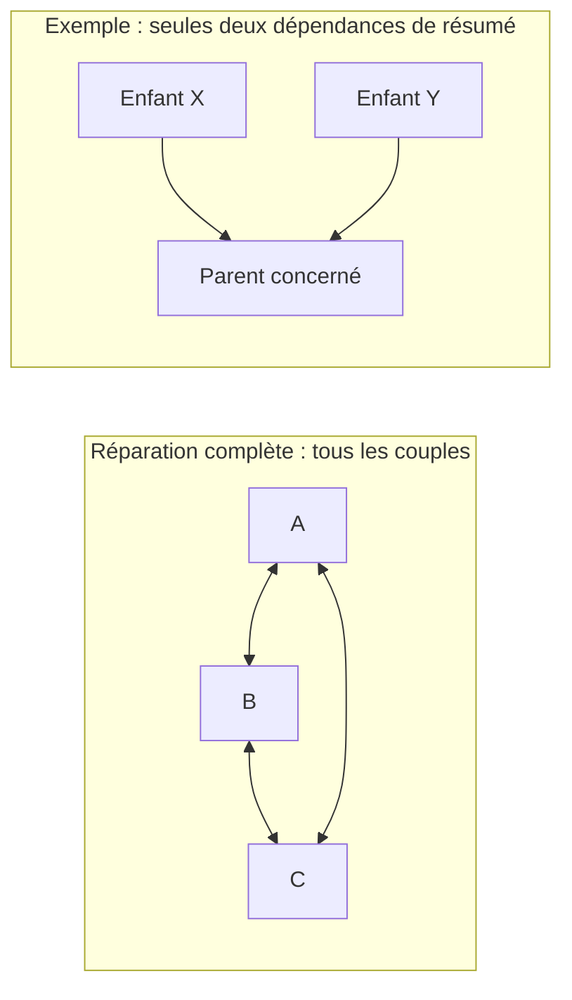

# Croissance du contrôle et stabilité des latences

Analyse du code `7fa2de5`, le 25 novembre 2026, puis revue croisée et corrections.
Les chemins cités sont relatifs à la racine de core. Le tableau de complexité
conserve le constat de départ ; le statut ci-dessous distingue ce qui a changé
et ce qui reste une cible. Les mesures et comptes de lignes sont dans
[la passe de qualification](../benchmarks/cleanup-scale-20261125.md).

## Statut après la première passe

| Sujet | État |
| --- | --- |
| Membership réencodée dans chaque commit d'autorité | Corrigé : blob interne immuable, digest conservé, écriture aux seules mutations de membership |
| Cellules recalculées par comparaisons entre tous les nœuds | Corrigé : chemin dans le trie XOR existant, oracle indépendant et tests de vues profondes |
| Polls de résumés détachés du contexte appelant | Corrigé pour les RPC de polling ; pushes, mutex et disque ne sont pas une deadline dure |
| Rotation qui saute les pairs après annulation partielle | Corrigé pour passages complets et fenêtres stables ; tests à 63 pairs |
| Références de membership préparées par export/JSON/hash complet | Toujours présent ; coût mesuré, à traiter par version immuable préencodée |
| Diffusion de snapshots quand la membership change | Toujours présente ; deltas et réparation bornée proposés, pas livrés |
| Poll complet de tous les pairs et reconstruction des frontières | Toujours présent ; inscriptions et index incrémental à concevoir avec les garanties de lecture |
| Spawn fabriquant un ancien DAG pour extraire des noms | Corrigé : noms du plan validé entier réservés directement ; ordre du plan explicitement conservé |
| Fragments, opérations et exceptions dans les commits locaux | Coût dépendant de l'état local actuel, à indexer et borner ; pas éliminé par le retrait de Knowledge |

## Ce que signifie le maximum de 3,9 secondes

Le résultat conservé est un **maximum de latence d'écriture**, pas un maximum de traitement de membership ni un gel mesuré par lot. Il comprend files, transactions, fsync, routage et réessais. Le lab fait fonctionner 64 disques logiques sur une seule machine, donc partage CPU, RAM et périphérique physique : l'augmentation du nombre de vnodes n'ajoute pas de capacité matérielle. On ne peut pas attribuer ce maximum à un seul composant depuis ce chiffre.

Le p99 ne se « linéarise » pas comme un total d'octets. L'objectif testable est un coût foreground borné par la zone et le lot, avec CPU/IO de fond admis dans la capacité disponible, à charge **par machine** constante. Convergence réseau, bootstrap complet et lecture globale ne peuvent pas tous avoir une durée constante indépendante du nombre de participants.

## Suite mesurée : inventaire de frontières

La [passe sur les allocations](../benchmarks/summary-work-20261125.md) partage
un inventaire de frontières entre parents. Sa clé est la **cellule XOR locale et
la révision de forme des zones** : une écriture dans une zone existante ou un
changement de membership qui conserve cette cellule ne reconstruit pas cet
inventaire. La découverte parcourt les identités spatiales, sans lire les sommes
ni `Only`, puis teste leur appartenance à la cellule. Elle utilise le trie et
`tree.Cell` existants ; `View.UniformOwner`, essayé dans une étape intermédiaire,
n'est pas conservé. La table ci-dessous conserve l'audit historique de
`7fa2de5`, pas une description inchangée du code actuel.

## Transferts : corrections en intégration le 25 novembre

Le chemin nominal `FLIP-ONE-1` regroupe fence et émission des preuves dans
`FenceZones` : **un commit source**. Le dernier delta, les sceaux et les preuves
partent dans `install-zone` ; `MountZones` certifie et monte le lot dans **un
commit receveur**. La copie chaude et les écritures de suivi/collecte restent
hors de cette fenêtre. Une divergence du miroir peut encore demander un second
échange avec le snapshot immuable fencé.

La préparation des snapshots/scellés de fence s'effectue en MVCC hors
`writeMu`, puis vérifie les séquences et l'état des zones sous le writer. Les
conflits reprennent une préparation fraîche, avec un nombre d'essais borné ;
ils ne déclenchent pas une relecture de payload sous ce verrou. L'installation
prépare aussi son staging hors verrou, mais les lectures de lignes nécessaires
au montage et à la comptabilité ne sont pas toutes éliminées du commit.
L'objectif « aucune lecture de contenu sous writer » n'est donc pas acquis.

Une porte locale du lot commence **avant** cette préparation : les nouvelles
écritures dont le détenteur reste ce disque attendent avant `Apply`, afin de ne
pas invalider continuellement la fence. Les écritures déjà entrées terminent.
Dès que le détenteur devient le receveur, elles sont relayées immédiatement,
même si l'ACK d'installation est encore perdu. Cette attente de préparation
s'ajoute à la latence client ; elle ne doit pas être confondue avec la seule
fenêtre durable fence→installation. Les autres lots continuent de servir.

Le worker réessaie une installation échouée avec une enveloppe de **1,5 s par
appel de reprise**, puis laisse la reprise durable continuer. Ce délai n'est
ni une borne du gel ni une restitution du droit source. Le chemin de dernier
delta n'a pas encore d'admission atomique par budget d'octets à la fence.
Les étapes 0–4 restent donc partiellement livrées, à qualifier sur le binaire
intégré. Les métriques `CommitStats.ByKind` séparent attente/tenue du writer,
tentatives, erreurs et commits logiques par type ; elles ne comptent pas les
fsyncs physiques et excluent l'admission bulk séparée.

L'étape 5 « lot = morceau natif » reste un audit préalable : `ZONE-2`, les points
provisoires et la consolidation régionale sont conservés. Aucun nouveau modèle
TLA+ ni nouveau protocole de sous-régions n'est qualifié par cette passe.

## Variables et chemins qui grossissent

Notations : `n` identités connues (actives + tombstones), `a` actives, `z` zones locales, `f` morceaux natifs locaux, `t` transferts locaux vivants, `d` exceptions de répertoire, `e` frontières de résumés, `h=96` bits d'adresse, `k` partenaires de gossip (environ log2(a) pour des IDs équilibrés, jusqu'à la profondeur effective).

| Chemin audité sur `7fa2de5` | Travail structurel observé | Pourquoi cela touche les queues |
| --- | --- | --- |
| `mesh.membershipWire.packet` | Snapshot/export, clone, JSON et SHA du corps entier O(n), même pour une référence ; parfois deux fois par exchange | Une référence O(1) octets n'est pas une opération CPU O(1) |
| `causal.Membership.Merge` | Copie maps, index des IDs, validation des retraits, tri des membres, reconstruction View/trie et hash ; O(n log n) pour la topologie, même delta déjà inclus avant détection extérieure du no-op | Gros travail de contrôle et allocations/GC lors des vagues de joins |
| `Service.Membership` puis `GossipTargets` | Reconstruit NewMembership + Merge(full), réexporte ; groupe et trie les buckets chaque round | Des états déjà calculés sont reconstruits au tick suivant |
| `storage.readCausalControlVersion` | Clone contrôle + copie de la membership entière | Une mutation locale charge/copiera des informations réseau sans rapport avec son morceau |
| `storage.writeCausalDigest` | JSON+SHA de toute la membership sur **chaque mutation de contrôle locale**, même si elle n'a pas changé ; puis JSON/hash de tous les droits/transferts locaux | Le coût réseau O(n) reste imbriqué sous la transaction locale après la fence ; retirer le graphe Knowledge ne l'a pas retiré |
| `RoutingSnapshot.Current` / `Membership.Current` | Clone du View et de ses maps O(a+n_retired) ; cache causal appelle même `m.Current()` deux fois lors d'un rebuild | Un lookup XOR déjà indexé peut être précédé d'une copie intégrale |
| `View.Owner` sur trie bulk-built | Au plus96 décisions, environ log(a) pour IDs équilibrés ; petits/mutés utilisent un scan | Le lookup pur est déjà bien meilleur que la préparation autour |
| `mesh.queryLimited` | Boucle sur chaque membre et appelle `tree.Cell` qui scanne tous les actifs : **O(a²)** avant les RPC de lecture ; jusqu'à8 tentatives si inventaire change | Même une lecture scoped paie une planification globale quadratique |
| `LocalPermissions.At/Find` | Scan O(f) ; installation/fences/hints scannent aussi O(t) | Le coût d'une écriture dépend de la fragmentation et des opérations vivantes locales |
| `ZoneHolder` | Vérification permission, transfers, lecture/décodage du répertoire et scan O(d), puis fallback membership | Un indice manquant peut provoquer un travail croissant avant un premier relais |
| `WriteRegionHint` | `Permissions.At` + scan des transferts ; soustractions géométriques | Ajouter un meilleur hint dans l'épilogue ACK n'est pas gratuit si f/t croissent |
| Résumés `Fold/boundaries` | Nouvelle membership/local-transfer revision redéclenche découverte ; marche spatiale avec `ZoneChildren`; chaque `Children` calcule aussi `Only` et des sommes/métriques alors que `boundaries` ne veut que Count ; `Only` peut répéter des recherches de clés/pages et de spans, mais ne lit pas les payloads utilisateur | Parcours et allocations supplémentaires sans rapport avec le seul dénombrement demandé |
| Résumés `Reconcile/PollRemoteHosts` | En régime calme fenêtre O(log a) mais force/start/fullTicks interrogent tous les hosts, en série ; chaque host énumère des contributions et répare les manquants | Au réseau, jusqu'à O(a²) paires après changements, pages supplémentaires selon e ; une panne multiplie les délais si budgets non propagés |
| Répertoire `read_delegation.go` / `CoversRegions` | Coût lié à d et aux morceaux résiduels intermédiaires ; les cubes arbitraires peuvent fragmenter lors des soustractions | Borner seulement les octets de données ne borne pas le travail géométrique |

Ces ordres sont des lectures d'algorithmes, pas une attribution de temps mesuré. La détection de saturation doit suivre les mêmes axes séparément : n, a, z, f, t, d et e. Un benchmark qui n'augmente que le nombre de zones laisse les autres facteurs invisibles.

## Projection explicite des snapshots : scénario de versions différentes

Hypothèse illustratrice : corps JSON `S(n)=86+200n` octets, ajusté au seul fixture64 (12 886 octets) ; pas une constante universelle. IDs équilibrés, `k=ceil(log2(n))`, un échange push-pull de deux corps complets par partenaire quand les versions diffèrent. Pas de compression ni en-têtes. Chaque ligne représente **un round logique défavorable**, pas un débit observé ni une prédiction de p99.

| n | k | Un corps | Par vnode, 2kS | Réseau, n×2kS | Comparaisons a² de la planification actuelle d'une lecture |
| ---: | ---: | ---: | ---: | ---: | ---: |
|64|6|12,9 Ko|0,155 Mo|9,90 Mo|4 096|
|256|8|51,3 Ko|0,821 Mo|210 Mo|65 536|
|1 024|10|205 Ko|4,10 Mo|4,20 Go|1 048 576|
|4 096|12|819 Ko|19,66 Mo|80,54 Go|16 777 216|
|10 000|14|2,00 Mo|56,0 Mo|560 Go|100 000 000|

Le stable même-version envoie des références : le trafic ne suit alors pas ce tableau, mais le code actuel continue à exporter/sérialiser/hash le snapshot pour les produire. Une rafale de nouvelles identités peut aussi déclencher plusieurs versions durant la propagation ; il ne faut pas multiplier aveuglément le tableau par chaque join, car les mises à jour se regroupent naturellement. Les mesures doivent conserver ce regroupement.

Le plafond4096 des receipts par peer garde la mémoire bornée ; au-delà, il peut évincer des connaissances de pair et provoquer davantage de corps complets. Il n'est pas un plafond de vnodes autorisés, mais ses coûts de cache-miss doivent figurer dans une projection10000.

## Limites mathématiques utiles au choix d'architecture

Une annonce que tous les nœuds doivent apprendre exige au moins Ω(n) réceptions réseau au total. Avec degré et budget par round bornés, sa diffusion ne peut pas atteindre arbitrairement beaucoup de nœuds en un temps constant : il faut au moins un nombre logarithmique de rounds dans le modèle de propagation à fanout borné. Une membership intégrale exige Ω(n) mémoire par vnode et un bootstrap intégral Ω(n) octets.

Si le churn est proportionnel à la taille du réseau, λ changements/vnode/seconde, une vue intégrale impose à chaque vnode Ω(λn) mises à jour/seconde. Des deltas réduisent la redondance, pas cette limite. Pour rendre le **contrôle par vnode** indépendant de n à churn proportionnel, il faut cesser d'exiger une vue globale et passer à des vues partielles / découverte / responsabilités régionales.

Une lecture exacte qui couvre k détenteurs indépendants doit recevoir suffisamment d'information de ces k détenteurs, ou s'appuyer sur un agrégat préalable dont le coût a été payé par la propagation des mises à jour. Aucun routage ne transforme gratuitement un total frais global en une opération locale constante.

Enfin, réduire le coût moyen n'est pas suffisant pour les queues. Pour une file M/G/1 idéalisée, E[W]=λE[S²]/(2(1−ρ)) : cette formule porte sur la moyenne d'attente, pas le p99, mais montre pourquoi une rare transaction longue et une utilisation proche de1 dégradent fortement les latences. Les budgets de fond et la durée maximale d'une section de commit comptent autant que les octets moyens.

## Approche adaptée la plus simple, par étapes

**1. Rendre les versions immuables réellement réutilisables.** Une mutation effective de membership publie une version avec son corps canonique, son digest et sa vue/index de placement une seule fois. Produire une référence, sélectionner les mêmes voisins ou prendre un snapshot de routage relit ces structures sans reconstruire. Les lecteurs n'exposent pas un View mutable à leurs appelants. Le contrôle local conserve un lien durable vers cette version, sans remarshal du corps lors d'une fence. Les CAS/digests restent exacts ; aucun événement d'autorité n'est validé par le réseau.

**2. Réconcilier des records actuels de membership, pas des événements d'autorité.** Une annonce de membre est son état courant monotone (identité immuable, endpoint/époque, retrait terminal). Envoyer les records modifiés avec duplication/rejeu sans effet ; retenir une file de diffusion compacte où la nouvelle annonce remplace l'ancienne du même membre. La queue de diffusion est une optimisation volatile : après éviction/restart, une anti-entropie répare. Un petit curseur de log de relais borné ou une décomposition par sous-arbres permet le rattrapage ; aucune preuve historique globale n'est requise pour écrire.

Attention : les annonces arbitraires ne constituent pas aujourd'hui un CRDT universel. Le code rejette les forks d'endpoint et les cycles de retrait ; la convergence déclarée est sur annonces honnêtes compatibles. Un nouveau transport ne doit pas prétendre transformer cette règle en semilattice générale sans modèle explicite. Il ne faut pas réutiliser le compteur d'un relais comme une époque d'autorité.

**3. Réparer par sous-arbres/pages bornées, avec fingerprint maintenu incrémentalement.** L'arbre binaire se prête à un digest par préfixe : égalité→rien, différence→descendre seulement dans les branches divergentes. Mise à jour d'un record en O(h), pages de records bornées, coûts de session admis. Pour64–1000nœuds, un corps complet paginé en fallback peut rester plus simple qu'une infrastructure Merkle, mais doit rester en dehors de la fence et être mesuré. Envoyer un hash O(1) recalculé depuis tous les membres à chaque message annule l'intérêt CPU de l'anti-entropie.

**4. Cibler les dépendances locales de l'arbre.** Installer un morceau publie immédiatement un hint de région réellement installée aux entrées actives et aux parents/résumés concernés. Les clients apprennent la région, y compris espace vide ; les exceptions suivent le morceau lors d'un join. Une annonce d'adresse est une route, jamais un droit d'écrire. Indexer droits, fences et répertoire par région / identifiant d'opération borne le coût local selon le chemin spatial, pas selon tous les droits. Pré-calculer les cellules sur le trie déjà construit retire le planificateur O(a²).

**5. Faire converger les résumés par arêtes concernées.** Push coalescé de valeurs versionnées et rattrapage par révisions/pages du peer concerné, avec traitement explicite des zéros et de l'indisponibilité. Éviter que tout changement distant déclenche un inventaire local complet puis un poll de tous les pairs. La lecture fraîche conserve le chemin de couverture et échoue sur un trou ; un cache asynchrone ne devient pas une preuve de total complet.

**6. Admettre et ordonnancer les tâches de fond par ressources.** Réserver CPU/IO aux écritures et lectures ; budgets en octets ET en temps/parcours pour copie, résumé, collecte et compaction. Le rattrapage avant fence peut ralentir ou se différer. Après fence, la reprise doit avoir un budget réservé et ne peut pas être abandonnée ou expirée au profit des nouvelles copies. Admission de nouveau receveur avant fence, puis très peu d'étapes durables, pas de priorités qui affament les clôtures.

**7. Vues partielles seulement lorsque les limites de la membership intégrale sont mesurées.** À très grande échelle, conserver voisins actifs/passifs et routes de préfixes peut réduire l'état par vnode. Cela nécessite une recherche des détenteurs et une migration des exceptions compatibles avec lectures régionales et résumés ; simplement remplacer membership par Kademlia brise ces dépendances. Le coût de cache-miss devient plusieurs RTT. Ne pas introduire ces RTT pour masquer le remarshal O(n) ou un planificateur O(n²) corrigeables localement.

## Ce que les autres systèmes apportent précisément

**SWIM : séparer détection et diffusion, petits échanges réguliers.** Le papier distingue le temps attendu de première détection et le travail par participant de la diffusion de la nouvelle à tous. Son module à membership faible ne donne pas une autorité d'écriture ni une preuve de retrait sûr. Indexus peut reprendre la séparation et le budget de message, sans adopter l'idée dangereuse « timeout→nouvel écrivain ». [Das, Gupta, Motivala, SWIM](https://courses.physics.illinois.edu/cs425/fa2020/SWIM.DSN02.pdf).

**Lifeguard : un observateur saturé peut se tromper.** Le mécanisme fait intervenir sa santé locale dans les suspicions ; CPU/IO lents ne signifient pas pair mort. Pour Indexus, cela inspire les mesures de boucle de maintenance et le backoff quand le donneur ou l'observateur est saturé. Cela ne justifie pas d'expirer une fence durable. [Dadgar, Phillips, Currey, Lifeguard](https://arxiv.org/abs/1707.00788).

**Memberlist : queue de diffusion invalidable et réparation complète moins fréquente.** L'implémentation compacte les annonces d'un même nom, limite les retransmissions et distingue gossip et push/pull complet. Reprendre ce pattern est plus pertinent que transmettre toutes les adresses lorsqu'un seul membre change. Ses défauts configurés sont des compromis, pas des objectifs de gel Indexus. [Queue officielle](https://github.com/hashicorp/memberlist/blob/master/queue.go), [configuration officielle](https://github.com/hashicorp/memberlist/blob/master/config.go).

**Delta-CRDT : envoyer un petit état fusionnable plutôt qu'une transaction à rejouer une fois.** Les deltas supportent canal dupliqué/désordonné selon les conditions du datatype et de l'anti-entropie. Pour une membership compatible, le record actuel d'un membre est un bon candidat. Cela ne s'applique pas à la consommation exclusive d'un droit. [Almeida, Shoker, Baquero, Delta State Replicated Data Types](https://arxiv.org/abs/1603.01529).

**Enes et al. : un delta naïf peut rester presque aussi cher que le full state.** Les répétitions et boucles de diffusion réexpédient de l'état déjà connu ; il faut mesurer le volume nouvellement appris, les duplicatas et les octets/CPU de contrôle par changement utile. Dire « on utilise des deltas » ne suffit pas. [Efficient Synchronization of State-based CRDTs](https://arxiv.org/abs/1803.02750).

**HyParView/Plumtree : état de voisins réduit et combinaison arbre+gossip.** HyParView utilise deux vues partielles pour garder un graphe robuste ; Plumtree préfère les branches efficaces pour le payload et garde des liens paresseux de réparation. Indexus a déjà un arbre d'adresses : ces mécanismes peuvent servir sa diffusion, mais ne remplacent ni la géométrie de placement ni les preuves locales d'installation. Ajouter maintenant une seconde topologie complète serait une complexité à justifier. [HyParView](https://asc.di.fct.unl.pt/~jleitao/pdf/dsn07-leitao.pdf), [Epidemic Broadcast Trees](https://asc.di.fct.unl.pt/~jleitao/pdf/srds07-leitao.pdf).

**Dynamo : deux avertissements directement pertinents.** Le papier traite explicitement la contention foreground/background et l'admission du travail de fond selon les latences observées. Il avertit aussi que la vue intégrale diffusée convient à des centaines de nœuds mais pose problème aux dizaines de milliers. Ses Merkle trees comparent des branches locales. Ses sloppy quorums et écritures concurrentes ne respectent pas l'exigence d'écrivain unique d'Indexus et ne doivent donc pas être copiés. [Dynamo, sections4.7,6.5,6.6](https://www.allthingsdistributed.com/files/amazon-dynamo-sosp2007.pdf).

## Qualification nécessaire pour aller au-delà des microbenchmarks

Mesurer64/256/1024/4096/10000identités sans réseau réel dans les microbenchmarks de contrôle ; séparer référence, merge no-op, un membre modifié, export/hash, planification scoped, lookup de droit avec f variable. Faire varier t,d,e indépendamment. Compter opérations/allocations/octets et plus grand temps détenu par commit, pas seulement ns/op moyen.

Pour un lab réseau, garder charge par machine et données par machine constantes ; annoncer le nombre de vraies machines. Faire des profils CPU, mutex, blocage et traces de commits avec identifiants de requête. À l'écriture maximale, joindre file d'admission, attente writeMu, temps WAL/fsync, phase de transfert et nombre de relais. C'est ce qui permet d'attribuer3,9s. Séparer les campagnes sans faute, avec perte d'ACK, disque lent et partition, puis les combiner.

Les assertions restent : pas d'ACK sans installation durable ; source interdite après fence ; rejeu après compaction sans remontage ancien ; lecture fraîche complète ; résumés sans double compte ; clôtures progressant sous trafic continu ; absence de travail proportionnel au réseau ou à l'historique après la fence. Les budgets de fond ne doivent pas affamer la reprise post-fence.

## Skills et documentation : constats de départ à corriger

1. `.agents/skills/indexus-layers/SKILL.md:10–13` dit que le vnode porte les zones les plus proches. Ajouter « placement souhaité » : les droits réellement installés peuvent différer pendant le transfert.
2. Même fichier:25, `internal/causal (certificats, topologie CRDT)` décrit l'ancienne architecture ; remplacer par droits/tickets locaux et membership compatible, sans graphe global d'autorité.
3. Même fichier:82–88, la liste « Ce qui ne bouge pas » fige un `causal/authority.go` absent et empêche l'amélioration de `tree/region.go` où se trouve justement Cell O(n). Exprimer des invariants, formats/vecteurs et tests à préserver ; ne pas rendre des fichiers immuables. Maintenir frontière de couches, atomicité et unique écrivain.
4. `.agents/skills/indexus-simplify/SKILL.md:92–93` exige d'arrêter/demander si le comportement change. Distinguer nettoyage sans changement de comportement et évolution déjà autorisée ; cette dernière demande un commit/tests séparés, pas une demande d'autorisation redondante. Les suppressions de travail d'un autre agent restent interdites.
5. `.agents/skills/indexus-gpu-path/SKILL.md:48–49` exige de servir l'ancien format pendant la bascule. L'utilisateur a explicitement déclaré l'absence de nœuds déployés et demande le nouveau seul. Conserver encodeur/décodeur/vecteurs coordonnés ; compatibilité transitoire uniquement si un besoin de déploiement réel est confirmé.
6. `docs/protocol/gossip.md:11` parle du dernier terme quadratique retiré : faux pour les octets de snapshot diffusés, les cellules de Query et les polls all-host. Le tableau historique reste utile en le bornant aux partenaires/round, pas à tout le contrôle.
7. Même document:82–88 parle de `NeedKnowledge` et d'historique de bundles. Le runtime répond `NeedBody` et garde sent/received digest ; décrire la proposition de deltas comme proposition, avec réparation bornée et record membership uniquement, sans restaurer un historique global d'autorité.
8. GOS-1 exige des identités stables et connues par le graphe considéré ainsi que des rounds logiques réussis ; les ticks réels ont des budgets et des lenteurs. La borne ne vaut pas comme durée murale de convergence durant des joins/partitions. « merging stays a join » doit être restreint aux annonces honnêtes compatibles, car le code rejette des cycles dont l'acceptation dépend de l'ordre.
9. `docs/protocol/local-permissions.md:318` distingue mal grain géométrique512clés/1Mio et unité de flip adaptable16..2048zones, par défaut64, but150ms. La doc doit nommer les deux niveaux sans promettre512comme borne universelle ; une seule zone/XOR indivisible peut dépasser le budget cible.
10. La phrase d'objectif `local-permissions.md:312–314` (aucune diffusion/reconstruction globale après fence) est une bonne exigence. Elle ne doit pas être présentée comme intégralement satisfaite en coût CPU tant que `writeCausalDigest` réencode la membership sur les commits locaux.

L'audit initial était en lecture seule ; les correctifs intégrés sont distingués dans le statut en tête et dans la qualification.

## Rectification de précision après revue croisée

`Snapshot.Children -> only` retrouve une localisation exacte à partir des clés/pages/sommes, sans lecture de payload utilisateur. La présence de `Store.payload` dans un échantillon natif ne peut pas être attribuée à ce chemin sans trace causale. Le gaspillage démontré ici est le calcul de Weight/Metrics/Only alors que `boundaries` utilise seulement Count.

## Précision supplémentaire : coalescence et transactions rares

Sur le snapshot original `7fa2de5`, `Store.CoalesceLocalRights` prépare les candidats hors writeMu avec maps de frères, tri O(f log f), puis O(96f) recherches au plus pour les droits/parents successifs. Chaque fusion appelle cependant `LocalPermissions.Coalesce`, qui recherche deux IDs par scans, clone toute la tranche Native et en supprime deux éléments. Jusqu'à f−1 fusions impliquent donc O(f²) éléments copiés/alloués dans le pire cas. Cela reste **hors writeMu** ; ce n'est pas un verrou quadratique détenu pendant tout le plan. Le CAS final réécrit le contrôle O(f+t), et le code original réencodait aussi la membership O(n).

`CompactReadDirectory` fait déjà le rang des stamps, la normalisation, le tri et le JSON hors writeMu, puis compare deux versions et publie les bytes. Avec t opérations et d entrées, les rangs coûtent O(d log t), les fusions par hash O(96d) amorti, puis O(d log d) de tri. Les boucles imbriquées ne justifient donc pas une qualification cubique de cette compaction. Ce bon pattern doit être conservé.

En revanche `replaceReadDelegation` et `MergeDirectory` sont des overlays transactionnels : lecture JSON du répertoire, soustractions, normalisation et JSON de sortie peuvent s'exécuter sous updateCausal et se répéter pour chaque morceau importé. Le coût dépend du nombre de referrals, de la frontière actuelle et des fragments intermédiaires ; il peut devenir superlinéaire. Pour lui attribuer une longue transaction, construire un benchmark en f,d et nombre de parts, avec durée détenue par writer, plutôt que conclure depuis le nombre de boucles.

Une optimisation à étudier est la construction d'un plan de fusion de tous les droits en maps, attribution des identifiants frais/du compteur dans le même plan, puis matérialisation de Native une seule fois et CAS local. Elle doit préserver droits épinglés, vérification des vrais frères et consommation des anciennes identités ; remplacer seulement le test de fratrie par un cache ne retire pas les clones O(f²).

## Autres couplages de progression à mesurer

`PendingSpawnNames` exporte actuellement les membres dans sa boucle sur les
réservations : O(P×N), avec copies et tri réitérés. Un index des noms connus ou un
export partagé par appel suffit à retirer ce produit ; ce point est identifié,
mais n'est pas modifié dans cette passe.

Correction du 26 novembre 2026 : les réservations retiennent désormais le point
cible et son propriétaire initial ; leur satisfaction dépend du propriétaire
actuel de ce point, pas d'une égalité entre cible et identité neuve. La lecture
ne reconstruit aucune vue quand il n'y a pas de réservation. Sinon, elle lit une
vue de placement une seule fois puis interroge chaque cible, sans réexporter
et trier les membres dans la boucle. Le writer reçoit la vue déjà préparée
pour la collecte de ces métadonnées. Le diagnostic ci-dessus reste celui du
snapshot historique.

`holdForTransfers` suspend les nouvelles décisions d'autoscale tant qu'un
transfert local reste ouvert et continue à committer des étapes. Le seuil de trois
minutes concerne **l'absence de progrès**, pas une durée maximale de transfert.
Un transfert très gros qui progresse lentement peut donc différer longtemps une
nouvelle demande de capacité. C'est une politique de contrôle, pas une nécessité
de l'écrivain unique. La remplacer demande une comptabilité du chargé/entrant/
sortant sans double compte et une admission par ressources/morceaux disponibles,
pour éviter de substituer une tempête de joins à une attente excessive.

La coalescence des droits planifie ses candidats hors du writer : la découverte
utilise les frères, mais les fusions successives recopient/parcourent des droits,
soit O(f²) dans le pire cas. Le commit final reste proportionnel aux droits et
opérations actuels. La compaction du répertoire prépare déjà son résultat hors
verrou avec contrôle de version au commit ; il faut préserver ce bon pattern.
Les overlays transactionnels répétés du répertoire méritent des benchmarks en
fragmentation ; les qualifier arbitrairement de cubiques serait insuffisant.

## Lecture du graphe cible

Pour une petite collection où deux détenteurs doivent seulement publier vers
un parent, le graphe utile n'est pas le graphe de tous les pairs :

Ce dessin illustre une collection, pas une preuve d'un degré constant pour
tous les placements. Le nombre d'arêtes utiles dépend des zones, collections,
frontières et du skew. Il faut borner et mesurer ces dépendances, pas remplacer
le mot « global » par « voisin » en supposant le coût disparu. Un parent très
sollicité et une lecture globale fraîche restent des ressources à dimensionner.

L'autorisation d'un morceau, elle, n'a pas besoin de parcourir ces graphes :
source persistante et receveur confirmé suffisent dans le modèle honnête. Les
autres participants apprennent des routes et des dépendances, sans participer
au commit de cette autorisation. Les publications différentielles et les budgets
de fond doivent préserver cette séparation.

## Publication disque : piste issue du profil, pas un retrait de mutex à l'aveugle

Le laboratoire final confirme un coût dans la publication des flush/compactions :
le segment se construit hors du mutex moteur, mais le manifeste durable se publie
encore sous lui. Une piste est un producteur local unique de versions/manifests :
épingler un état cohérent, effectuer l'I/O durable hors du mutex des données,
puis publier brièvement la version en mémoire. Les créations de collections,
les séquences visibles/durables, l'ordre WAL, la récupération et la collecte des
anciens fichiers doivent rester cohérents avec cette séquence.

RocksDB sépare ainsi la sérialisation des producteurs de manifests de la tenue
du mutex DB pendant leurs I/O ; le code prépare un état à utiliser après libération
du mutex. Cela fournit un pattern à étudier, pas une preuve que l'on peut enlever
le verrou actuel sans autre mécanisme. [VersionSet / ProcessManifestWrites](https://github.com/facebook/rocksdb/blob/main/db/version_set.cc).

Cette évolution doit avoir ses propres tests de crash après synchronisation du
segment, du manifeste et avant/après publication, avec anciennes vues épinglées.
Elle n'est pas livrée dans cette passe.

## Références courtes sans dépendance au cache de chaque pair

Une première simplification du transport serait une version courante préencodée,
calculée une fois par mutation. Si une référence reçue est identique à cette
version locale canonique, l'absence de reçu spécifique à l'expéditeur ne devrait
pas obliger à renvoyer son corps entier. Un défaut de cache de pair n'implique
pas forcément un état différent. Cela mérite un test après éviction et reprise.
Le protocole actuel ne réalise pas encore cette optimisation.

Les records différentiels et un rattrapage borné restent nécessaires pour de
vraies différences. Garder une membership complète impose toujours un bootstrap
O(N) si on l'exige avant le premier trafic. Pour obtenir un relais très précoce,
il faudra aussi qualifier le démarrage depuis l'identité du cluster, la source
et la responsabilité déléguée, avec acquisition de la vue complète en arrière-plan.
Les chemins de lecture et les renvois du morceau doivent alors rester trouvables.
Ce n'est pas équivalent à retirer les contrôles d'autorité du receveur.
