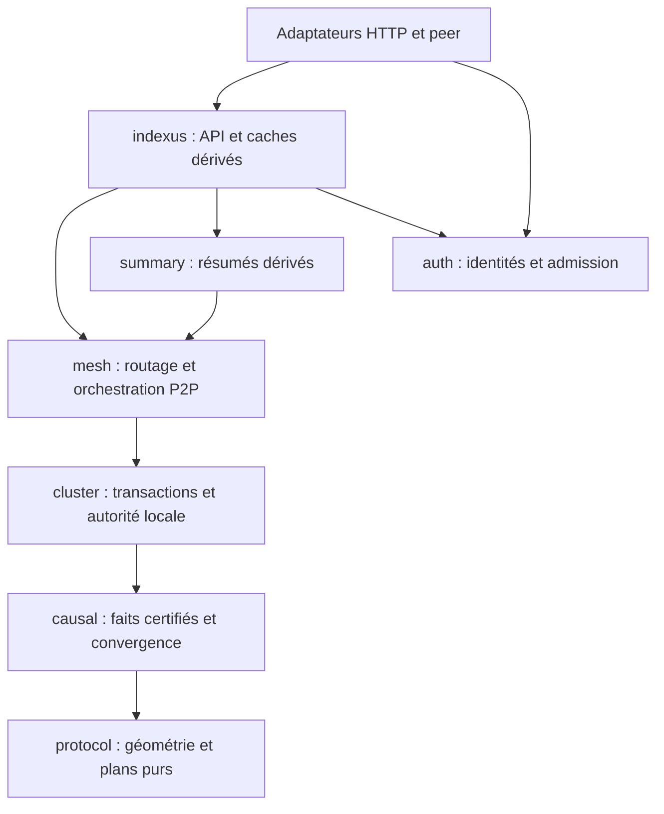

# Frontières du runtime causal — revue du 2 novembre 2026

**Statut : historique.** Revue datée du 2 novembre 2026 ; elle cite `internal/cluster` et Bolt. Le fonctionnement actuel est décrit dans [README.md](../architecture/README.md).

Portée : refonte locale non commitée de `core`, protocole causal par défaut.
Les résultats du simulateur `protocol-sim` et les anciennes campagnes AWS ne
qualifient pas ce runtime. Aucun déploiement ni publication GitHub dans cette passe.

## Responsabilités et surfaces

| Partie | État possédé | Surface autorisée | Ne confère pas |
| --- | --- | --- | --- |
| `internal/protocol` | vues, géométrie XOR, plans et modèles locaux | calculs déterministes, validation sur la vue fournie | autorité disque, connaissance d'un concurrent caché |
| `internal/causal` | activations, dépendances, certificats, placements | merge de faits compatibles, résolution des chaînes | installation de bytes ni droit local d'ACK |
| `internal/cluster` | records, séquences, reçus, staging, grants installés et fences | transactions Bolt, reprise durable | reprise automatique d'un disque perdu |
| `internal/mesh` | coordination locale des joins/handoffs, messages | appels aux transactions et échanges via `Transport` | règle d'ownership supplémentaire, validateur global |
| `indexus` | API, routage dérivé | appels au mesh et aux résumés | permission d'écrire fondée sur un arbre ou un total |
| `internal/summary` | résumés dérivés des zones : contributions des enfants distants, bords à pousser | lecture des sommes du store, push et poll via le mesh | permission d'écrire |
| `internal/auth` | certificats d'identité et credentials client | signature, vérification et admission | membership actif ou grant d'écriture |
| banc | arrivées, workers, observation et provisionnement simulé | déclencheur de splits et audits après exécution | validation des transitions du protocole |

`TestProductionDependencyBoundaries` contrôle le sens de ces dépendances.
Les deux couches pures ne dépendent pas d'IO disque/réseau ; seul `cluster`
importe Bolt. L'ancien import `indexus → adapter/auth` a été supprimé : les
identités sont partagées dans `internal/auth`, sans changement de cryptographie.
Le moteur local legacy de `indexus.Node` a été supprimé : aucun repli queue/WAL
ni autorité fondée sur une collection en mémoire. Les projections de lecture
ne sont pas des sources d’autorité.
Ce contrôle d'imports ne constitue pas une preuve complète de tous les effets.

## Lecture, connaissance et autorité installée

`DataStore.CausalRouting` retourne un `RoutingSnapshot` opaque. Ses champs ne
sont pas exposés ; il ne possède ni `Merge`, ni installation, ni accès aux maps
de preuves ou à la liste de tokens installés. Ses méthodes sont : identité,
vue copiée, digest de membership, frontier copiée, placement, destination de
routage, cible connue d'autorité, grants copiés et statistiques dérivées.
Les transactions internes continuent à travailler sur leur état détaché.

`Route` suit XOR puis le placement. `HolderOfZone` suit la chaîne d'autorité
connue pour le forwarding. Les deux résultats sont des indications de route.
Un ACK exige toujours la vérification transactionnelle de l'état local actuel.
`TestRoutingQueriesCannotMutateDurableKnowledge` vérifie l'absence de fuite par
la vue, les grants, les statistiques et la frontier retournés.

Le cache distingue désormais :

1. les **faits certifiés** : root, genesis, contenu exact du delta, réplique et
   graphe de preuves validés ;
2. le **contrôle local** : staging, fences, états de migration, installation et
   identité du disque, correspondant aux octets exacts de la transaction.

Un changement de phase locale peut réutiliser les mêmes faits. Il ne réutilise
jamais une décision « writable ». La lecture des droits reste dans la transaction
d'écriture. Deux versions exactes du contrôle permettent aux lecteurs Bolt
anciens/récents de coexister ; les reconstructions concurrentes sont regroupées
par un mutex local. Ce mutex n'ouvre aucune transaction et n'effectue aucun RPC.

Les IDs de transactions Bolt ne servent pas d'identités de cache : un rollback
peut les réutiliser. `TestKnowledgeReuseDoesNotReuseLocalFencesAcrossRollback`
exerce ce cas, vérifie le refus pendant le gel et le retour à l'état persisté
après rollback. Le digest des faits seul n'autorise jamais une écriture.

## Invariants et portée des vérifications

| Invariant | Responsable | Évidence et limite |
| --- | --- | --- |
| `OWN-1`, `TOPO-1` : même ensemble actif, même argmin XOR | `protocol` | oracle indépendant et propriétés ; ensemble actif fourni en entrée |
| `HOT-1` : fork canonique et absence de déplacement d'un tiers | `protocol` | tests exhaustifs bornés et fuzz sur la vue d'entrée ; pas un certificat d'absence de pairs cachés |
| `CRDT-1/2` : union compatible, dépendances et trous de frontier | `causal` | lois, duplications, réordonnancement et partition/reunion bornés |
| `ACT-1` : l'acquisition partielle permet l'activation et reste historique | `causal` + `cluster` | preuve acquise avant publication ; transfert ultérieur ne révoque pas l'activation |
| `AUTH-1/2/4` : chaîne unique, consommation irréversible et reprise | `cluster` | fences, reçus, reopen de disques et coupes durables ; hypothèses crash-recovery du failure model |
| `AUTH-3`, `ROUTE-1` : seule l'autorité installée ACK | `cluster` | snapshot de route sans mutation ; autorité et fence revérifiées dans le writer |
| `HND-4`, `ZONE-2` : gel et ordre enfants avant parents | `cluster` + `protocol` | transitions transactionnelles et vagues de gel indépendantes de l'ordre des maps |
| `AGG-1` : compteur dérivé, versionné et réparable | `internal/summary` | fold/delta idempotents ; aucune fraîcheur bornée sous partition |
| identité des records `(collection, zone, ID)` | données et oracle du banc | régression sur IDs identiques dans des zones/collections distinctes ; détection de corruption conservée |

Le « zéro vol externe » du kernel est relatif à sa vue. Une vue locale n'est pas
un recensement complet sous partition. Le compteur `StolenRows` du banc est un
diagnostic d'observation non atomique et exclut des donneurs de mouvements
concurrents ; il ne remplace pas la preuve géométrique ou la sûreté des grants.
La sûreté d'autorité et la convergence sur l'ensemble actif sont deux obligations
distinctes. Les essais n'établissent pas une preuve non bornée de toutes les exécutions.

## Ce qui échoue dans les tests extrêmes

Les deux tests utilisent la même charge : 12000 insertions proposées à 4000/s,
32 workers, trois vnodes initiaux, splits au-delà de 1500 lignes, budget de
récupération 30 s. La limite globale des requêtes est donc environ **33 s**.
Le mode est `logical-batch` : la synchronisation physique est désactivée.

Reproductions persistées, avant les corrections de cette passe :

| Chemin | ACK | Échéances expirées | Charge |
| --- | ---: | ---: | --- |
| complet, sans scale | 12000 | 0 | 3,23 s |
| service mesh nu, avec scale | 10431 | 1569 | fin du budget |
| complet, avec scale | 8131 | 3869 | fin du budget |

Le service nu emploie aussi un observateur différent ; ce contrôle n'est pas
une mesure isolée du coût des compteurs. Il montre que retirer la couche dérivée
ne suffit pas. Le profil identifie la reconstruction répétée du contrôle et des
preuves pendant les migrations. Les transferts continuent à progresser, puis se
terminent et l'audit des ACK réussit : aucun deadlock permanent n'est observé dans
ces exécutions. Les échecs client persistés sont `context deadline exceeded`.

Avec reconstruction regroupée, l'essai complet atteint 8922 ACK ; en séparant
les faits certifiés du contrôle local, il atteint 11204 ACK. Ces exécutions
restent `inconclusive` au budget initial. Aucune échéance ni charge n'a été
relâchée dans les tests. Leur message d'échec expose maintenant les ACK, refus,
indisponibilités, durée et nombre de vnodes, en plus des écarts d'audit.

Un essai à budget plus long est un diagnostic de progression, pas une réussite
du test à 33 s. Le succès d'un invariant de sûreté ne promet pas ce débit matériel.

Une passe intermédiaire des deux tests originaux a réussi (46,09 s et 47,00 s),
avec cinq vnodes sur le premier scénario. La requalification finale avec les clés
de zone complètes a toutefois reproduit l'échec du premier test : sept vnodes,
9621 ACK, 2379 échéances, charge 33,56 s ; audits et résumés sans erreur.
Les succès intermédiaires ne qualifient donc pas la performance extrême :
le nombre de splits et leur ordonnancement changent fortement le coût du contrôle.
La charge proposée à 4000/s n'est pas un débit soutenu démontré. Le second scénario
(`TestScalingSpawnsAreDonorOnly`) réussit en 48,16 s après les mêmes corrections.
Les durées des tests incluent le drain, les acquisitions et les audits ; elles
ne représentent pas seulement la durée d'insertion.

Qualification conservée dans `outputs/indexus-boundaries-2026-11-02` :

- `final-race.log` : toutes les suites hors les deux stress tests passent avec
  `-race`, à l'exception de cinq lectures HTTP vides dans `cmd/node`.
- Après correction de ces lectures, `read-repair-race.log` valide `cmd/node`,
  `indexus` et `internal/cluster` ; les autres paquets n'ont pas changé depuis
  leur qualification précédente. Aucun avertissement de data race.
- `zone-identity-qualified.log` : cas parent/enfant de même ID, preuves séparées,
  conservation des flags à adresse zéro et handoff Bolt avec un seul writer.
- `extreme-zone-identity.log` : premier stress test inconclusif pour le débit,
  second réussi, sans relever les délais.
- `final-vet.log` et `final-diff-check.log` : aucun diagnostic.

Le cache et l'isolation réduisent des reconstructions inutiles ; ils ne règlent
pas le transport systématique de fermetures complètes ni le gros blob local.
Les pourcentages CPU cumulés sous `bbolt.View` incluent le décodage et la validation
appelés depuis une transaction : ils ne mesurent pas une attente disque ou un
fsync. Le contrôle sans scale réussit à charge identique, même avec Bolt.

## Lecture des résumés et données directes

La qualification élargie a reproduit des lectures HTTP vides après des ACKs,
y compris pour un record à la racine. Un cache de résumés absent ne prouve pas
qu'une zone durable est vide ; un total direct ne contient pas les IDs des rows.
`meshSetFromSummary` refuse désormais ces deux réponses incomplètes et laisse
la requête lire l'inventaire durable via le mesh. La lecture publie les ancêtres
des writes locaux en attente ; un refresh explicite contourne le cache de résumés.
Les tests existants de join HTTP, suppression et redémarrage qualifient ce chemin.
Les autres résumés restent dérivés et soumis à leur convergence ; ils ne donnent
jamais la permission d'ACK.

## Identité des zones et adresses coïncidentes

La collection `0000000000000001` avec les chemins `0`, `00`, `000` donne
réellement la même adresse dans le codec actuel. Ces trois zones restent distinctes.
Les clés de moves, DAG, barrières, autorités cold et traces de forwarding utilisent
désormais `(collection, chemin)`. Les statistiques du plan ne sont plus écrasées
par une autre zone de même adresse. Le DAG relie le plus proche ancêtre affecté
par parcours du chemin, en O(nombre de zones × profondeur), au lieu de comparer
toutes les paires. La profondeur d'adresse est bornée à 16 caractères.

La résolution d'une preuve ACT1 vérifie l'identité complète de la zone transférée.
Un contre-exemple a été reproduit : avec le prédicat historique limité à l'ID,
une preuve de transfert d'enfant pouvait activer un vnode présenté avec une preuve
de parent. Ce cas échoue maintenant à s'activer tant que la preuve du parent manque.

Le test mesh utilise Bolt et un véritable join P2P : trois zones d'ancêtres, même
adresse, même ID de record. Après chaque installation il vérifie un seul writer
pour chacune des zones et l'ordre petit-enfant → enfant → parent. Il couvre aussi
l'adresse zéro : elle est légitime pour une zone et ne peut servir de marqueur
« zone absente » dans la validation des transferts ou le merge des flags locaux.
`HolderOf(ID)` reste une requête géométrique de compatibilité ; les chemins servant
les données et les preuves doivent utiliser l'identité complète.

**Écart du codec restant ouvert.** Un calcul indépendant remplace bit à bit le
préfixe d'une collection et compare le suffixe documenté au codec. Pour
`0AABCDEFGH123456`, les chemins `0A` et `0AA` divergent ; `0AAB` est aligné
sur un octet et concorde. `combineBytes` recopie des bits hauts de collection
dans la partie basse de l'octet partiel. Le codec n'a pas été changé : cela
remapperait des zones déjà persistées. Une version explicite du schéma d'adresse,
avec migration des index et des preuves, est nécessaire avant sa correction.
Les tests de zones coïncidentes utilisent les adresses réellement produites,
sans supposer que cette formule est déjà correctement implémentée.

## Couplages encore ouverts

- Chaque échange peut encore transporter la fermeture complète des preuves.
  La frontier des activations n'acquitte pas les chaînes de transferts.
- Le document de contrôle local ne garde plus l'état des zones des transferts
  terminés, et la connaissance a sa propre clé (voir
  [linear-knowledge.md](linear-knowledge.md), E5a et E5b). L'historique des
  certificats, lui, croît encore avec le nombre de handoffs.
- Il n'existe pas de scheduler de production général P0/P1/P2/P3 isolant les
  budgets des writes et du contrôle. Les priorités cold/hot documentées sont
  un modèle de référence ; REMOVE froid et W1 restent désactivés.
- La compaction des preuves/fences et l'oubli sûr des reçus exigent une règle
  de sûreté séparée. Les supprimer pour accélérer les tests invaliderait les reprises.

La prochaine optimisation du réseau doit définir un acquittement indépendant
des preuves de transfert, ou un protocole de demande de fermeture manquante.
Un cache de membership ou un timeout ne peut pas remplacer cette connaissance.

## Complément : handoffs successifs et audit des agrégations

La campagne ultérieure à 60000 records a trouvé un défaut supplémentaire :
une ancienne installation de zone pouvait masquer le gel d'un nouveau départ
par sélection arbitraire d'une entrée historique. Le prédicat transactionnel
vérifie désormais tous les gels avant d'autoriser, puis l'installation de
l'opération actuelle. L'inventaire complet refuse aussi les sorties gelées dont
l'installation n'est pas confirmée. Voir les contre-exemples et la qualification
avant/après dans [aggregation-verification.md](aggregation-verification.md).
