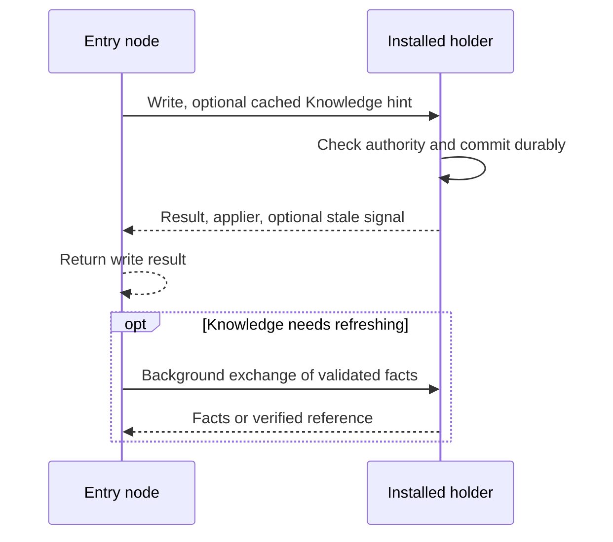

# Write routes: relay or direct

**Statut : routes relay/direct conservées ; ancien transport Knowledge historique.**

> **Remplacement du 25 novembre 2026.** Les sections Knowledge ci-dessous
> conservent l'ancien découplage et ses DTO, désormais retirés du protocole actif.
> Il n'existe plus de mode legacy ni de corps Knowledge pour écrire. La
> [membership séparée](local-permissions.md) fournit les indices de route ;
> seules les permissions installées autorisent l'ACK. Voir la
> [qualification actuelle](local-permissions-verification.md).

A client may send a write to any node. Two ways to reach the owner of its
zone exist side by side, as read policies do; the node behaves the same in
both, and the client chooses.

| Route | Behavior |
| --- | --- |
| `relay` (default) | The node that receives the write applies it if it owns the zone, and otherwise relays it once to the owner. The client needs no map. Every node the client writes through waits for the owner: one slow owner slows the writes of its zones on every entry (2026-11-20: 97 % of writes relayed, a stalled owner held writes on the whole cluster). |
| `direct` | The client writes to the owner it learned. Nothing waits on a third node; a slow owner slows only its own zones. The client keeps a small map of cells. |

## How a client learns owners

The answer to a relayed `POST /item` carries two headers:

- `X-Indexus-Owner`: the address of the node that applied the write;
- `X-Indexus-Owner-Cell`: that owner's cell as `mask/value`, 12 bytes each
  in hexadecimal. A key belongs to the cell when its zone ID `& mask ==
  value`.

A write applied where it was sent carries neither. The receiving node
computes the cell from the view it holds, only for a relayed write.

A `direct` client keeps the cells it was given and writes a key to the owner
of the most specific cell holding it, through any node when none does. A
cell learned replaces the cells it overlaps (a split gives smaller cells, a
fold a larger one). A route is a hint, never authority: a stale one reaches
a node that no longer owns the zone, which relays as in `relay` and answers
with the current owner. An owner that does not answer is forgotten.

Single-writer safety does not depend on the route: the owner's disk decides
(`writableIn`), whichever node the write came through.

## Knowledge on the write path

Knowledge carries validated causal facts, not installed bytes or permission
to write. The mesh separates exchanging those facts from acknowledging a
mutation. A current peer sends `write` with `AsyncKnowledge: true`, no Knowledge
body and no mandatory Knowledge reference. `KnownKnowledge` is only the hash
of an already-built bundle, possibly stale or zero. Obtaining that hint never
rebuilds a bundle or a missing storage control snapshot.
The node's local write API also opts into this path without constructing a
Knowledge version before entering the mesh.

The receiver still checks authority in the commit transaction. Its compact
reply contains the write result and, when needed, `KnowledgeStale`; it does
not build or attach global Knowledge, including on a refusal. A stale cache
cannot authorize an uninstalled zone. Explicit incoming Knowledge bodies and
mandatory references retain their validation before dispatch.

There is at most one asynchronous exchange worker per host and eight workers
per mesh Service (vnode), including retries. Each worker makes at most two
attempts, with a five-second context per attempt and a short failure backoff.
At saturation a hint is dropped, not a write: later writes and periodic gossip
retry convergence. `gossip.async_sync_dropped` and `async_sync_failures` expose
these conditions. This is eventual convergence, not a millisecond deadline.
Shutdown cancels workers before closing their store; waiting for another frame
builder or bundle merger is cancellable. A validation/commit already executing
must finish, and transports must honor cancellation.

The Go `mesh.Writer` asks for compact replies too. After success it remembers
`AppliedBy` for that exact `(collection, location)` in a bounded cache. This
does not update certified membership or imply ownership of adjacent zones.
The next write can go directly to that applier without merging global facts
before returning the ACK. A failed route is invalidated; a routing refusal can
require a dedicated synchronous refresh before retrying the same RequestID.
Capacity refusals remain refusals. Optional legacy metadata after a successful
write is not merged and cannot turn its committed result into a metadata error.
Concurrent refreshes merge on a private replica clone and briefly publish it;
they do not hold the routing/ACK mutex during validation.

Old callers without `AsyncKnowledge` keep their metadata-bearing relayed
replies. An old receiver may ignore the flag and still build a full response;
both ends must be updated to remove that receiver-side wait.

## Knowledge during granular cutover

The donor exchanges causal dependencies before freezing pending lots. Frozen
lots then use compact `mirror`, `stage-zone` and `install-zone` RPCs, including
the full-frozen-snapshot repair path. Resuming an emitted installation uses
the receiver's previously persisted dependencies. Granular regional stage and
installation also use compact replies. The payload still carries the operation's
seals, transfers or certificate; all storage checks remain mandatory. Missing
dependencies fail the operation rather than installing by gossip.

After durable completion, a dedicated synchronous exchange preserves the
join's topology/summary convergence barrier. It can delay the end of Join,
but the installed zones already accept writes while it waits. Per-lot compact
responses do not spawn competing global merges.

Thus a frozen lot does not wait on the global Knowledge carrier. This does not
remove its final mutation copy, durable cession, installation, first activation,
or optional replication costs. Legacy non-granular handoffs retain their
existing framing. There is no hard freeze-duration guarantee.

`handoffs.install_to_first_write_us_log2` measures installation to first local
apply, including demand arrival delay. It does not include subsequent replica
acknowledgement or delivery of the response to the client.

## Verification

- `TestRelayedWriteNamesItsOwnerAndCell` (indexus): a relayed write names
  its owner and a cell holding the zone; a write to the owner names nothing.
- `TestRoutesFollowSplitsAndFolds` (cmd/experiment): the client map through
  splits, folds, malformed routes and a lost owner.
- `knowledge_decoupling_test.go` (mesh): writes with both frame builders held,
  legacy metadata not delaying a committed result, bounded/cancellable workers,
  and a prepared frozen lot becoming writable with the builders still held.
- `experiment load -route direct` uses it; `STEP_ROUTE=direct` on AWS. Not
  yet measured on AWS.
