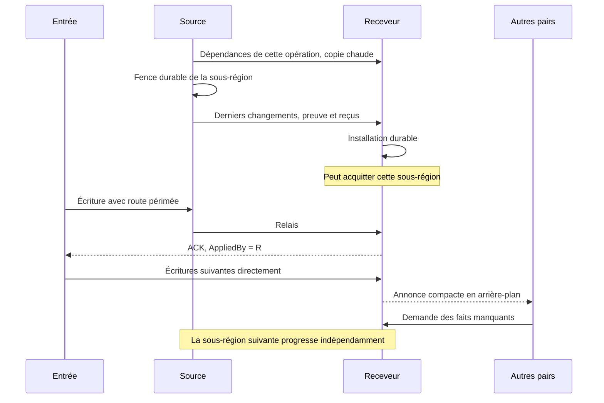

# Knowledge : convergence, droits locaux et diffusion incrémentale

**Statut : recherche, première étape branchée dans le worktree, 24 novembre 2026.** Lecture de Lightning
BOLT 2/7, Agave CRDS, et des recherches citées ci-dessous. Ce document distingue
le code constaté dans le worktree `codex/transfer-progress-20261124` des
évolutions proposées. Il ne constitue ni une nouvelle garantie ni un résultat AWS.

## Le choix qui paraît le plus adapté à Indexus

Garder l'autorité exclusive sur chaque zone, mais permettre à la connaissance
de cette autorité de se diffuser progressivement. Une écriture doit dépendre du
disque qui la valide, pas de la synchronisation de l'historique de tous les pairs.
Le nouveau vnode commence à servir une sous-région dès que son installation
durable est terminée. Les autres nœuds apprennent ensuite à le joindre directement.

Trois objets ont des rôles différents :

| Objet | Question | Décision |
| --- | --- | --- |
| Arbre binaire et membership connu | Vers quel vnode cette adresse devrait-elle aller ? | Indice de route, qui peut être périmé |
| Faits d'autorité et de placement | Comment les droits et les disques ont-ils évolué ? | Historique validé, réconciliable |
| État installé et fences sur disque | Ce disque peut-il acquitter cette écriture maintenant ? | Vérification locale dans le chemin de commit |

L'adresse d'un vnode suffit à calculer une préférence XOR dans une vue donnée.
Elle ne prouve ni l'arrêt de l'ancien écrivain, ni l'arrivée des données chez le
nouveau. Deux partitions peuvent avoir des vues différentes. Le code le dit
explicitement : `TopologyReplica.Route` est un indice et `Authority` n'installe
aucun droit d'acquitter.

## Ce que Lightning apporte

BOLT 7 distingue annonces de nœuds, annonces de canaux et paramètres de routage.
Ses requêtes ciblent des identifiants de canaux ; les filtres de timestamps et
checksums évitent de redemander des informations identiques. BOLT 2 décrit les
engagements entre les deux parties d'un canal et leur reprise après déconnexion.
La carte publique n'est donc pas l'état qui engage les fonds du canal.
[BOLT 7](https://github.com/lightning/bolts/blob/master/07-routing-gossip.md),
[BOLT 2](https://github.com/lightning/bolts/blob/master/02-peer-protocol.md).

**Application proposée :** un transfert Indexus doit avancer avec son identité
d'opération, ses séquences et ses reçus persistants. Les pairs non participants
n'ont pas à confirmer chaque lot. Ils reçoivent une annonce compacte, puis
demandent seulement les faits absents. Une réponse perdue rejoue la même opération.

La limite de l'analogie est importante : Lightning dispose de Bitcoin et de
mécanismes de règlement des canaux. Indexus ne peut pas en déduire une protection
contre un détenteur malveillant ou une reprise automatique après perte du disque.

## Ce que Solana / Agave apporte

CRDS réplique des valeurs par label plutôt qu'un document global indivisible.
Le gossip combine push, élimination des doublons, prune et pull avec filtres de
Bloom. Le code départage généralement les versions par wallclock puis hash,
avec un traitement particulier des contacts. Cela permet des mises à jour
partielles des enregistrements.
[Service gossip](https://docs.anza.xyz/validator/gossip),
[CRDS](https://github.com/anza-xyz/agave/blob/master/gossip/src/crds.rs).

**Application proposée :** séparer les informations de contact, les indices de
route et les faits d'autorité. Envoyer les nouveautés à quelques pairs, puis
réparer les manques par anti-entropie. Un filtre de Bloom peut réduire le trafic,
mais son résultat ne prouve jamais la possession d'un droit. Ses faux positifs
doivent être compensés par des requêtes exactes ou des réconciliations ultérieures.

Choisir le propriétaire par « timestamp le plus récent » serait dangereux : deux
disques pourraient déjà avoir acquitté avant que le réseau choisisse un gagnant.
Une règle de convergence de métadonnées ne répare pas cet historique d'ACK.

Turbine répartit la propagation des données sur plusieurs couches de relais à
fanout limité. C'est une inspiration pour éviter un émetteur qui envoie tout à
tout le monde ; ce n'est pas une règle d'attribution de droits.
[Turbine](https://docs.anza.xyz/consensus/turbine-block-propagation).
Dans Indexus, réutiliser des voisins de l'arbre pour diffuser serait une piste,
avec des contacts supplémentaires et du pull pour réparer les branches coupées.
Ne pas imposer une vue identique à tous comme préalable à cette diffusion.

## Les recherches les plus proches

**Delta-state CRDTs.** Envoyer de petits états fusionnables, avec une
anti-entropie qui assure leur livraison éventuelle. Le travail ultérieur sur la
synchronisation montre qu'envoyer des deltas ne suffit pas : leurs rediffusions
redondantes peuvent annuler le gain.
[Almeida, Shoker, Baquero](https://arxiv.org/abs/1603.01529),
[Enes et al.](https://arxiv.org/abs/1803.02750).
Pour Indexus : suivre ce que le pair a effectivement reçu, pas seulement
« une version différente existe ».

**Merkle-CRDTs.** Des faits adressés par contenu et leurs dépendances permettent
de récupérer les parties manquantes d'un graphe causal. Le payload doit lui-même
avoir une sémantique convergente : ajouter des hashes ne transforme pas une
attribution exclusive en CRDT. Les auteurs signalent aussi les coûts de reprise
à froid des longues chaînes et le problème de compaction.
[Sanjuán et al.](https://arxiv.org/abs/2004.00107).
Pour Indexus : réutiliser les digests et liens `Previous` existants, demander les
ancêtres manquants par lots, et prévoir des snapshots de reprise. Éviter un RTT
par ancêtre et un nouveau DAG contenant des copies de tout l'état global.

**Escrow / bounded counters.** Les droits sont répartis à l'avance ; une opération
locale consomme seulement les droits disponibles localement. Cette méthode
permet de préserver certains invariants sans coordination globale permanente.
[Balegas et al.](https://arxiv.org/abs/1503.09052).
L'analogie proposée pour Indexus est géométrique : un grant est un droit exclusif
sur une région, qu'un certificat peut partitionner en sorties disjointes.
Ce n'est pas l'application directe du CRDT numérique de l'article.

**Invariant confluence.** Analyser les invariants permet de coordonner seulement
les opérations qui en ont besoin.
[Bailis et al.](https://arxiv.org/abs/1402.2237).
Dans notre application : diffuser des faits compatibles est indépendant ;
consommer deux fois le même grant ne l'est pas. Le point de coordination utile
est le détenteur durable de ce grant, pas tout le cluster.

## Ce qui est déjà présent dans le code

- `Certificate.Previous` consomme un token et produit une partition exacte,
  disjointe. `Authority.Add` refuse deux successeurs différents d'un même token.
- `Holder` lie vnode, host et incarnation du disque. Un disque neuf ne récupère
  pas les anciens droits par simple réutilisation d'un nom.
- `TopologyReplica` conserve des activations en attente. Sa frontière
  n'acquitte que les opérations contiguës validées, sans sauter les trous.
- `Authority.Merge` traite une chaîne réordonnée, mais refuse atomiquement un
  lot dont un ancêtre manque. Les placements incomplets peuvent aussi refuser
  le lot. La réception des faits et leur publication restent donc couplées.
- `DeltaSince(frontier)` filtre activations et retraits, mais retransmet intents,
  placements et fermeture des certificats. La frontière de membership ne
  représente pas la connaissance des chaînes d'autorité indépendantes.
- `acceptKnowledge` fusionne avant d'exécuter les appels synchrones concernés ;
  `respondKnowledge` renvoie une trame complète si les versions diffèrent.
- Le worktree découple déjà les écritures, les étapes préparées des lots et les
  résumés. Au départ de cette étude, la synchronisation générale transmettait
  encore des paquets complets ; le transport incrémental est désormais branché
  dans le worktree, avec qualification décrite dans le rapport de benchmark.

Les structs `Certificate` et `ZoneTransfer` inspectées portent des digests, pas
de signature cryptographique propre. Leur nom ne doit pas laisser entendre une
preuve byzantine. Le [modèle de panne](../protocol/failure-model.md) exclut
explicitement les pairs byzantins et le stockage malhonnête.

## Première étape implémentée dans le worktree, avant toute refonte

1. **Conserver les règles d'autorité.** Ne modifier ni l'exclusivité ni la
   transaction qui décide l'ACK pour optimiser la circulation de Knowledge.
2. **Négocier un transport incrémental.** Identifier les faits par type et
   digest ; envoyer ceux absents d'une base confirmée par le pair. Une trame
   complète reste le secours pour un pair ancien, un redémarrage ou une base
   évincée. Un delta ne prétend pas avoir le hash de l'état complet.
3. **Borner la mémoire de déduplication.** L'éviction provoque un rattrapage,
   jamais une modification des permissions. Une annonce ou un Bloom ne vaut
   pas un reçu de validation.
4. **Préparer les dépendances avant le gel.** Les échanges de copie et de
   bascule utilisent les faits de l'opération déjà préparés. Le receveur
   commence dès son installation durable ; la diffusion globale continue.

Cela retire la duplication réseau tout en gardant les validateurs existants.
Le coût CPU des clones et validations de l'historique doit être mesuré séparément :
un petit paquet n'implique pas encore un petit coût de fusion.

Une seconde évolution, plus intrusive, serait une boîte de réception persistante
de faits en attente, indexée par dépendance manquante. Elle permettrait de recevoir
un enfant avant son parent sans rejeter tout le paquet. Trois états devraient
rester explicites : reçu, validé, installé. Seuls les faits validés avanceraient
la frontière ; la réception ne donnerait aucun droit d'écriture. Cette boîte
nécessite quotas, reprise et politique de conflits. Elle n'est pas implémentée.

La réunion de faits compatibles est commutative et idempotente. Deux successeurs
contradictoires d'un même token ne deviennent pas compatibles par union : les
conserver comme observations ne permet pas de les publier tous deux comme droits.
Le modèle crash-recovery repose sur l'émission unique persistante à la source.

## Déroulement souhaité d'une sous-région

Le gel comprend le drainage des écritures engagées, la persistance de la fence,
le rattrapage final, les validations, le réseau et l'installation durable.
Supprimer Knowledge de ce chemin retire une cause d'attente, sans garantir à lui
seul un plafond en millisecondes. Si le receveur tombe après le point irréversible,
un timeout ne suffit pas à rendre les droits à la source.

Le transfert géométrique inclut l'espace encore vide. Basculer seulement les
zones existantes ne soulage pas correctement une charge qui crée continuellement
de nouvelles adresses. Le travail sur les sous-régions répond à cette différence.

## Mesure locale disponible et critères de validation

Le run `lab64-summary-routing` du 24 novembre a terminé ses 64 joins : 8 192 zones
initiales, 5 671 écritures offertes et acquittées, aucun refus terminal ni abandon
de queue ; audit des ACK sans perte, sans double propriétaire inscriptible et
sans région gelée restante. Les résumés et écritures ont transporté zéro octet
Knowledge. **Les échanges généraux en ont encore transporté 1 510 276 949 octets.**
Le problème de volume global n'est donc pas résolu par le seul découplage.

Ce laboratoire utilise une seule machine physique, fsync et HTTP/JSON, avec 32
partages de périphérique simulés ; il ne démontre ni 16k/s sur AWS, ni un temps de
gel réseau garanti. Les compteurs ont été relus dans `events.jsonl` ; le manifest
du run conserve le patch source. Voir aussi
[l'enquête de transfert](../benchmarks/transfer-recovery-20261124.md).

Pour comparer la future diffusion incrémentale : rejouer le même profil avec
paquets complets et deltas ; mesurer octets Knowledge par type, octets copiés,
faits nouveaux/doublons, CPU et temps de fusion, dépendances manquantes, première
installation, premier ACK, première route directe, fin du join et durée de chaque
tentative gelée. La part Knowledge/données doit inclure le gossip de fond et être
mesurée avec différentes tailles de payload : elle peut dominer de minuscules
zones sans constituer un coût fixe proportionnel à leur contenu.

Les vérifications à ajouter au modèle borné et aux tests Go sont : livraisons
réordonnées/dupliquées/perdues ; base delta évincée ; reprise disque ; frontière
avec trou ; héritage de droits disjoints ; refus d'un second successeur ;
absence d'installation par simple réception de faits. La vivacité suppose
livraison éventuelle, pairs nécessaires disponibles et ordonnanceur équitable.

Un arbre de diffusion équilibré à fanout limité permet une profondeur
logarithmique idéale ; cela ne borne pas la latence réelle. Si tous les participants doivent connaître
un fait, sa diffusion reste au moins linéaire en leur nombre de destinataires.
L'objectif est d'éviter de retransmettre l'historique entier à chaque changement.

## Carte des changements et suites possibles

| Fichier / couche | État ou suite | Motivation |
| --- | --- | --- |
| `internal/mesh/knowledge_delta.go` | Ajout dans ce worktree | Différence des six catégories de faits, couverture immuable, cache borné, identité de cluster et hash de paquet lié à la base |
| `internal/mesh/knowledge_wire.go` | Modifié | Négociation, envoi/réponse incrémentaux, validation avant dispatch, repli complet, indices complets distincts des reçus |
| `internal/mesh/service.go` | Modifié | Champs additifs `KnowledgeDeltas` / `KnowledgeBase`, sélection de réponse sans changer la décision d'autorité |
| `internal/mesh/knowledge_delta_test.go` | Ajout | Base évincée, intégrité, ancêtre absent, concurrence, ancien pair et budgets |
| `internal/mesh/knowledge_wire_test.go` | Adaptation explicite du contrôle legacy | Le test de trame complète force désormais le chemin sans delta ; les nouveaux tests couvrent les deltas |
| `spec/handoff/knowledge_sim.py` | Ajout | Modèle abstrait de 64 pairs, pertes et reprise des caches, comparaison complète/incrémentale |
| `indexus/lab64_test.go` | Réutilisé sans changement pour les deltas | Vrais services, HTTP/JSON et disques ; audit de rétention et d'exclusivité |
| `internal/causal/topology.go` | Suite à profiler | Clones de graphes, fermeture des dépendances et coût de `Merge` ; frontière de membership insuffisante pour les certificats |
| `internal/storage/causal_data.go` et `causal_cache.go` | Suite à profiler | Coût transactionnel de publication, sérialisation et reconstruction après nouveaux faits |
| `internal/mesh/service.go` (`Knowledge`) | Suite possible | Construire les données exportées depuis un index incrémental plutôt que reconstituer l'histoire complète |
| `internal/mesh/knowledge_delta.go` | Suite si les budgets saturent | Couvertures partagées/compactées pour éviter de dupliquer des ensembles de digests ; pas une dépendance de sûreté |
| `internal/mesh` (gossip) | Suite indépendante | Push borné de nouveautés et pull exact ; éviter une dépendance à une vue collective identique |
| `internal/summary` | Suite distincte | Réduire les réparations aux dépendances pertinentes ; ne pas confondre cela avec la fraîcheur d'une lecture utilisateur |
| `internal/causal/authority.go` | Sémantique conservée | Aucun changement de consommation des tokens, de partition exacte ou de résolution des conflits pour cette étape |
| SDK et API d'écriture | Aucun changement requis par ce transport | Le client non négociant conserve les paquets complets et l'ACK durable existants |

Les suites sont des hypothèses à mesurer, pas une liste de refactorings à appliquer
sans preuve. Le modèle de panne doit évoluer explicitement avant toute reprise
automatique du droit d'un disque définitivement perdu. La boîte persistante de
faits pending et une compaction des preuves restent des projets séparés.

### Ajustement après le premier run réel : couvertures conservatrices

Le modèle initial conservait la réunion complète des identifiants de faits
rencontrés dans une chaîne de reçus. Cela peut retenir des preuves ponctuelles
qui ne sont plus exportées après un certificat régional, et consommer inutilement
le budget de cache. L'implémentation réduit donc une couverture aux faits encore
exportés, sans y ajouter un seul fait absent de l'ancienne couverture.

Si `C` est la couverture connue du reçu et `U` l'univers actuellement exporté,
la réduction est `C' = C ∩ U`. Elle conserve `C' ⊆ C` : un oubli peut provoquer
une retransmission, jamais une fausse connaissance chez le pair. Après émission
d'un delta depuis une base, l'émetteur peut retenir son snapshot courant entier
comme couverture du nouveau reçu : chaque fait courant était dans la base ou a
été inclus dans le corps. Les snapshots restent immuables, le cache remplace
seulement ses pointeurs. Un test vérifie explicitement qu'un fait local nouveau
ne se retrouve pas inventé dans un reçu plus ancien.

### Pourquoi cette convergence reste compatible avec un écrivain exclusif

Dans une exécution admissible, soit `K` l'ensemble des faits compatibles reçus.
Le transport vise `merge(K1, K2) = K1 ∪ K2`. La publication de la vue exige
ensuite les dépendances et preuves prévues par les validateurs existants.
La projection « propriétaire actuel » peut changer ; ce n'est pas elle qui
constitue l'ensemble croissant. L'état installé sur disque et ses fences restent
un objet distinct de cet historique diffusé.

L'unicité du successeur est assurée à l'émission par le détenteur durable du
token. Un autre modèle qui autorise deux émetteurs indépendants à consommer le
même droit ne peut pas utiliser cette réunion comme preuve d'exclusivité. Il
faudrait alors modifier le modèle de panne, la réplication et l'arbitrage.
Le fait qu'une fusion refuse un conflit n'est donc pas un défaut à effacer pour
obtenir une API « toujours convergente » : c'est une limite explicite de son
domaine de faits compatibles.

La priorisation des lots ne change pas avec les deltas : les contraintes de
descendants avant parent restent dans la planification existante. Les unités de
copie (64 zones maximum et cible 1 Mio) ne sont pas la même borne que la cible
advisoire de sélection géométrique (512 zones déjà présentes). Ni l'une ni
l'autre ne borne le nombre futur de nouvelles zones ou la durée d'un gel sous
panne. L'installation de sous-régions inclut leurs adresses encore vides.

### Point à challenger avant un essai de très gros volume

La subdivision géométrique produit davantage de certificats permanents. Même
avec des deltas parfaits, le nombre de faits historiques peut donc dépendre du
nombre de morceaux transférés, et pas seulement du nombre de vnodes. Le transport
incrémental ne supprime pas ce coût de stockage, de validation ou de reprise.

`cmd/experiment/sentinel.go` compare encore la taille d'une trame Knowledge à
4 096 octets par vnode. Une exécution légitime à nombreuses subdivisions pourrait
dépasser ce budget. Il faut qualifier séparément la taille des métadonnées de
membership, celle des preuves historiques et l'amplification de diffusion. Le
seuil ne doit pas être relevé arbitrairement pour faire passer le test : le coût
attendu et une éventuelle compaction doivent être explicités et vérifiés.
Ce garde-fou n'a pas été modifié dans cette étape. Le prochain essai AWS devra
prendre ce risque en compte ; aucun essai cloud n'a été lancé ici.

### Réutiliser un reçu appris ailleurs dans le réseau

Une base par pair ne suffit pas à éviter toutes les répétitions : lors d'un
premier contact, le destinataire peut déjà avoir reçu exactement la même trame
par un autre voisin. Le protocole sonde donc une référence au snapshot complet
lorsqu'il possède localement sa couverture et que celle-ci couvre effectivement
ce snapshot. Si le destinataire ne la connaît pas, il refuse avant dispatch et
le paquet complet est renvoyé une fois. Aucun ACK métier perdu n'est supposé
reçu, et aucun delta n'est envoyé à un ancien pair sans négociation.

Le test à trois pairs échoue sur la première implémentation delta : A répète à C
la trame que B lui a déjà donnée. Il passe avec cette sonde. Le harnais de coupure
MVCC conserve le signal `NeedKnowledge` d'un refus avant inventaire et ne consomme
sa coupure qu'après acceptation ; ses assertions de rétention des ACK restent
inchangées. La coupure, la sonde et la compatibilité passent sur vingt répétitions.

## Suites prioritaires après qualification de cette étape

1. **Amplification et cache de transport** (`knowledge_delta.go`,
   `knowledge_wire.go`, compteurs `metrics.Gossip`). Le dernier run expose encore
   beaucoup d'évictions et de paquets complets. Comparer une rétention des bases
   réellement utilisées, une représentation partagée des couvertures et un journal
   borné de publication par session. Un tel journal pourrait remplacer un ensemble
   de faits par pair par un curseur : epoch au redémarrage, détection des trous,
   rattrapage complet si le curseur sort de la fenêtre et capture cohérente du
   snapshot initial seraient indispensables. Ce journal n'est pas implémenté.
2. **Refus pendant la bascule** (`write.go`, barrières de `flip_units.go`,
   fences de stockage, instrumentation du loader). Le dernier run a une écriture
   refusée par une fence lors de ses cinq tentatives. La rétention des ACK tient,
   mais l'offre n'est donc pas acquittée à 100 %. Les logs doivent corréler
   request ID, cible, tentative, opération et phase pour distinguer l'attente
   d'installation, une route périmée et une saturation. Ne pas masquer cela en
   augmentant simplement le nombre de retries du banc.
3. **Fusion proportionnelle au changement** (`topology.go`,
   `Store.MergeCausal`, `causal_cache.go`). Profiler les clones, la fermeture
   canonique et la publication. Les déplacer hors du verrou d'écriture réduit
   une contention directe, mais leur consommation CPU et disque reste partagée.
4. **Historique et reprise à froid** (certificats, stockage des preuves,
   `Knowledge`, budgets du sentinel). Définir un checkpoint/une compaction qui
   préserve la détection des anciens tokens consommés et les preuves citées.
   Une suppression arbitraire des ancêtres n'est pas une compaction sûre.
5. **Qualification plus proche d'AWS** (`lab64_test.go`, agent d'expérience).
   Rejouer avec beaucoup plus de certificats et plusieurs processus/machines.
   Les 64 services du laboratoire partagent un ordinateur et certains caches de
   processus ; cela diffère de deux vnodes par EC2. L'autoscaler et le
   provisionnement réels ne sont pas reproduits par les joins programmés du banc.

## Questions de relecture pour un autre modèle

- Le domaine des faits compatibles et l'hypothèse d'émission unique par token
  suffisent-ils aux arguments de convergence avancés ici ? Où un fork devrait-il
  être refusé, conservé comme observation ou rendu visible à l'opérateur ?
- Une couverture conservative peut-elle, dans un entrelacement réel, confirmer
  un fait qui n'a pas été validé ? Vérifier arrivée hors ordre, activation pending,
  éviction, redémarrage et compaction des preuves ponctuelles.
- La sonde d'une référence complète apprise ailleurs garde-t-elle toujours son
  refus avant dispatch ? Examiner particulièrement les transports intermédiaires,
  la lecture fraîche et les étapes de transfert idempotentes.
- Les budgets de cache provoquent-ils encore une amplification sous création
  continue de certificats ? Un curseur de journal de publication par session
  donnerait-il un code et un état plus petits que des ensembles de couverture ?
- Chaque nœud doit-il vraiment recevoir tout l'historique des certificats ?
  Quelles fermetures de preuves pourraient être demandées par région de l'arbre,
  sans casser l'activation, le routage ni la rétention des ACK dans une lecture ?
- Quelle compaction conserve la preuve de consommation des anciens tokens,
  sans exiger un accusé de réception de tous les participants ? Expliciter les
  hypothèses de reprise d'un pair longtemps hors ligne.
- Quelle instrumentation manque pour expliquer l'écriture refusée cinq fois par
  la fence ? Le budget client, le buffer de cutover et la clôture régionale
  doivent-ils être coordonnés différemment ?
- Les mesures locales justifient-elles la complexité ajoutée ? Proposer un
  contre-exemple, un contrôle négatif ou une alternative plus simple avant de
  changer le protocole d'autorité. Ne pas transformer les résultats synthétiques
  en promesse de latence réseau ou de disponibilité pendant une partition.

## Réponse à la relecture de Claude : première étape de la frontière

La recommandation du 24 novembre est retenue : commencer par la compaction et
ses contre-exemples, garder la membership complète et le transport actuel,
puis traiter ensemble diffusion par voisinage, lectures régionales et migration
des exceptions. Les k-buckets actuels choisissent les partenaires gossip ; aucune
recherche itérative Kademlia n'est introduite.

Le [contrat de frontière](../protocol/authority-frontier.md) décrit le code de
cette première étape et le changement de confiance. Les anciens modèles et
mesures ci-dessus restent des résultats historiques du transport incrémental,
pas des mesures de la future Knowledge limitée à la membership.

L'autorité courante est un ensemble de grants avec contexte causal, fusionné
par observation/suppression. L'état installé et les fences restent sur chaque
disque. Les modèles ajoutent explicitement compaction, vieux messages, crash,
restauration et fusion de deux entrées. Une restauration qui efface les dernières
fences sous la même identité reste interdite : le contre-exemple est conservé.

Les étapes suivantes ne doivent pas être confondues avec ce checkpoint :

| Étape | Code concerné | Condition de qualification |
| --- | --- | --- |
| Diffusion membership seule | `causal/topology.go`, `mesh/service.go`, `knowledge_wire.go`, `knowledge_delta.go`, cache de stockage | Aucun certificat régional ni checkpoint complet d'autorité dans le gossip ; admissions validées et tombstones convergentes |
| Préparation entre participants | `storage/causal_data.go`, `mesh/handoff_stream.go`, `service.go`, `flip_units.go` | Le receveur dispose des droits et de sa réservation avant la première fence ; aucun fetch de dépendances globales après la fence |
| Annuaire de délégations | `storage/query.go`, `inventory_page.go`, `routing.go`, `mesh/query.go` | Toute lecture régionale suit aussi les exceptions et leurs descendants ; pas de succès partiel si une branche manque |
| Migration de l'annuaire | `mesh/service.go` (join/move), `storage/cold.go`, `causal/retirement.go` | Pointeurs durables chez le successeur avant activation/retrait ; test avec ancien détenteur éteint |
| Résumés | `internal/summary`, façade `indexus` | Totaux et métriques exacts pendant/après transfert et migration des pointeurs, sans vue d'autorité globale |

Le checkpoint actuel conserve une **frontière complète connue**, pas seulement
les droits locaux. Couper simplement sa diffusion maintenant laisserait des
lectures et des joins dépendre de pointeurs qui ne migrent pas encore. Cela
retirerait de la vivacité sans retirer un coût de manière correctement prouvée.
Le remplacement du transport doit donc être un changement cohérent avec
l'annuaire, et non une suppression isolée des champs Knowledge.
